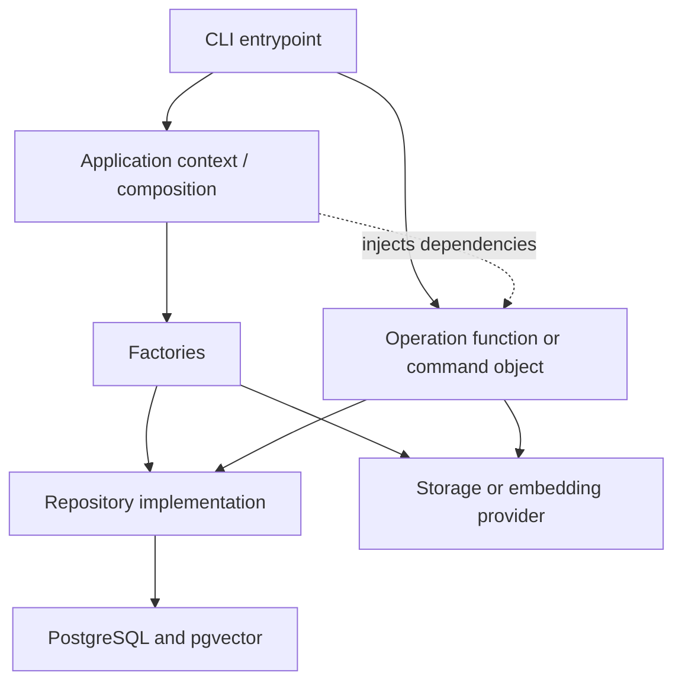

# Code conventions

These conventions guide both human contributors and coding agents. [AGENTS.md](../AGENTS.md) provides the concise working instructions; [README.md](../README.md) describes installation and command usage. [Database](DATABASE.md) covers database setup, schema, migrations, and CRUD services.

## Architectural intent

Keep entrypoints thin and business behavior independently testable. Select abstractions according to their responsibility and complexity. A command object and a factory solve different problems and can be used together.

The reference is Cloudband's Rails template at commit `6c4b0f7db504bee0f560e1661dc5f309f37dc628`. Its [agent instructions](https://github.com/cloudband-solutions/default_api_rails/blob/6c4b0f7db504bee0f560e1661dc5f309f37dc628/AGENTS.md) and [Users::Save operation](https://github.com/cloudband-solutions/default_api_rails/blob/6c4b0f7db504bee0f560e1661dc5f309f37dc628/app/operations/users/save.rb) demonstrate thin entrypoints delegating to feature-specific objects with explicit inputs and an execution method. RyPiq adopts that separation while keeping Python exceptions, dataclasses, repositories, and existing function-based operations. Rails-specific routing, persistence, and validation payload conventions are not imported.

## Choose the appropriate pattern

| Responsibility | Preferred pattern | Decision rule / current example |
| --- | --- | --- |
| Coordinate a multi-step or stateful business use case | Command object | Prefer a descriptive class with `execute()` for new workflows that benefit from named inputs, dependencies, or intermediate steps. Use `IngestDocument`, `EmbedTextFile`, or `SearchDocuments`; existing operation functions remain compatibility entrypoints. |
| Perform a small stateless operation | Function | Retain simple calls such as `process_text_file()`; do not wrap every function in a class. |
| Select and construct an implementation | Factory | Reuse `get_database()`, `get_storage()`, and `get_embedding_provider()`. Even a single supported backend can have a factory as its composition boundary. |
| Read/write persistent domain records | Repository | `DocumentRepository` defines the contract; `PostgreSQLDocumentRepository` implements queries and serialization. |
| Adapt an external capability | Provider/backend | Storage providers, embedding providers, and the PostgreSQL backend encapsulate their infrastructure details. |
| Select a known handler by name | Explicit dispatch mapping | Database `METHODS` maps supported CLI commands to service methods. A registry selects behavior; it does not own business rules. |
| Represent domain data | Dataclass | `Document`, `SearchResult`, and `StoredObject` carry data without opening connections or orchestrating operations. |
| Assemble and release application resources | Composition context | `ApplicationContext` owns the database lifecycle; its consumers borrow the repository and storage. |

Do not add a command bus, dependency-injection container, generic repository, or shared command superclass merely to make the architecture look uniform. Introduce an abstraction only when the requested behavior or demonstrated reuse warrants it.

## Dependency flow



This diagram shows responsibilities, not a literal call graph: the database factory constructs a backend, and the backend exposes its repository. Small library callers may inject dependencies directly without creating an application context.

- **Entrypoints** parse arguments and handle presentation. Operations do not receive an argparse namespace, print JSON, or call `sys.exit()`.
- **Operations/commands** express business intent using injected interfaces. They do not embed SQL, select adapters, or read environment variables to obtain hidden dependencies.
- **Repositories** implement persistence and database search, including parameter binding and conversion to/from dataclasses.
- **Providers/backends** implement infrastructure capabilities. Factories may initialize providers when construction requires it, but must not initiate an unrelated business workflow.
- **Composition** loads configuration, constructs dependencies, and determines ownership. The existing application includes some combined orchestration/composition functions; separate them when a substantive change benefits from injection, not through an unrelated rewrite.

## Commands and operation functions

### When to use a command object

Use a command object when a named business workflow coordinates several steps, dependencies, or execution-specific state. Give it one public execution method, `execute()`, with an annotated result. Prefer descriptive names such as `UpdateDocumentSource` or `IngestDocument`, rather than vague names such as `Manager` or `Service`.

Constructors accept explicit keyword-only inputs and dependencies and only store them. Validate business inputs and perform effects during `execute()`. Private helpers may separate validation and steps when that improves readability. Keep invocation state local where possible; do not introduce cached success/error state merely to mirror the reference implementation.

An invocation normally constructs a command and executes it once. Do not infer that executing the same command again is safe, cached, or idempotent; document and test repeat-execution behavior when the use case requires it. A returned result means the operation completed; do not swallow an exception and return a success-shaped value.

### When to keep a function

Prefer a function for a direct transformation or small stateless operation with clear inputs and a return value. Existing public functions retain their contracts. Adding a command does not require converting all neighboring functions or moving every module into a new hierarchy.

A command may delegate to an existing function to avoid duplicating behavior. If a public function becomes a compatibility wrapper around a command, retain its signature, result, and exception behavior and test existing callers.

### Placement and naming

- Keep business operations under `app/operations/`, using `snake_case` modules and `PascalCase` classes with verb-based names.
- Group operations into domain packages: `applications`, `documents`, `embeddings`, `processing`, `storage`, and `inference`. Place each action in a descriptive module, such as `documents/ingest.py`; keep closely related helpers with their action.
- Import directly from action modules. Package `__init__.py` files do not eagerly re-export operations. Add new actions to their owning domain rather than extending a flat catch-all module.
- Keep configured Python entrypoints, including `embed_text_file()` and `ingest_document()`, in `app.application`. Operations must not import that composition layer. See [namespace migration](EXECUTION_PATHS.md#operation-namespaces-and-import-migration) for the import map.
- Infrastructure command facades can stay in their subsystem. The existing `DatabaseCommands` exposes `create()`, `migrate()`, `drop()`, and `reset()` for explicit CLI dispatch. It is not a single-use business command and does not need an `execute()` retrofit.
- Use type annotations for new public interfaces, explicit keyword arguments for dependencies, and existing repository/provider contracts. Follow nearby formatting; avoid unrelated repository-wide formatting changes.

## Illustrative command and tests

The following three Python blocks form one illustrative example module. `UpdateDocumentSource` is **not a shipped class**, and this guide does not require implementing it. The example uses existing RyPiq types; its tests need neither a database nor a model. A real implementation would place the command in its feature module and import it in the corresponding test module.

```python
from uuid import UUID

from app.database.repositories.base import DocumentRepository
from app.models.document import Document


class UpdateDocumentSource:
    def __init__(
        self,
        *,
        document_id: UUID,
        source: str,
        repository: DocumentRepository,
    ) -> None:
        self.document_id = document_id
        self.source = source
        self.repository = repository

    def execute(self) -> Document:
        if not isinstance(self.source, str) or not self.source.strip():
            raise ValueError("Source must be nonempty")

        document = self.repository.get(self.document_id)
        if document is None:
            raise KeyError(self.document_id)

        document.source = self.source
        return self.repository.update(document)
```

```python
from unittest.mock import Mock
from uuid import uuid4

import pytest


def test_command_updates_the_loaded_document():
    document = Document(content="existing text", source="old", embedding=[1.0, 0.0])
    repository = Mock(spec=DocumentRepository)
    repository.get.return_value = document
    repository.update.return_value = document
    command = UpdateDocumentSource(
        document_id=document.id,
        source="new",
        repository=repository,
    )
    repository.get.assert_not_called()  # Construction performs no I/O.

    result = command.execute()

    repository.get.assert_called_once_with(document.id)
    repository.update.assert_called_once_with(document)
    assert result is document
    assert result.source == "new"


def test_command_rejects_invalid_source_before_io():
    repository = Mock(spec=DocumentRepository)
    command = UpdateDocumentSource(
        document_id=uuid4(), source=" ", repository=repository,
    )

    with pytest.raises(ValueError, match="nonempty"):
        command.execute()

    repository.get.assert_not_called()
    repository.update.assert_not_called()
```

```python
def test_command_does_not_write_a_missing_document():
    repository = Mock(spec=DocumentRepository)
    repository.get.return_value = None
    command = UpdateDocumentSource(
        document_id=uuid4(), source="new", repository=repository,
    )

    with pytest.raises(KeyError):
        command.execute()

    repository.update.assert_not_called()
```

Use fakes/mocks to verify observable boundaries and side effects, not internal private-method call sequences. Real database behavior needs integration coverage in addition to these isolated tests.

## Results, validation, and errors

- Return the existing domain object, collection, or documented result dictionary when extending an operation. For a new complex result, a small typed dataclass may clarify the contract; do not introduce a universal result envelope.
- Validate inputs before effects where possible. External conditions may still change between validation and execution; preserve the underlying atomic guarantees and failure handling.
- Use clear existing exceptions such as `ValueError`, `KeyError`, and relevant I/O errors. Add a domain-specific exception only when callers need a distinct recovery path. Expected validation failures remain exceptions, not Rails-style field-error payloads.
- Handle expected failures at the CLI boundary, preserving established JSON output, exit codes, and sanitized messages. Lower layers do not format terminal responses.
- Preserve unexpected failures rather than converting them into apparent success. Avoid broad catch-and-continue blocks. Catching broadly for cleanup or sanitized entrypoint diagnostics is appropriate when the original failure is preserved or execution fails clearly.
- Never include credentials, full connection URLs, or raw driver messages in public diagnostics. Distinguish partial completion when a command crosses independently committed boundaries.

## Factories, transactions, and resource ownership

Keep factory functions in the relevant subsystem. They load or accept validated settings, choose supported implementations, and return the declared interface. Reject unsupported selections explicitly. Do not add placeholder adapters or configuration switches for hypothetical future backends.

Prefer explicit dependency injection at operation boundaries. A factory creates resources; the composition caller owns their lifetime. For example, use `with create_context() as context:` or `with get_database() as database:` and pass the needed repository/provider to the operation. Commands must not close caller-owned resources, and exception paths must release resources created by the composition layer.

A command class does not create a transaction automatically. The current repository commits individual write methods; wrapping several such calls in a command does not make them atomic. When a new feature needs multiple database changes to commit together, define an explicit shared transaction contract at the repository/backend boundary and test rollback on the real database. Do not add an unused unit-of-work abstraction preemptively.

Object storage and PostgreSQL do not share a transaction. Multi-system operations must specify sequencing, ownership, compensation, and what happens if cleanup itself fails. The existing ingestion operation is a reference for intended compensation, not proof of atomicity across systems. Test injected failures at the relevant boundaries; never delete another operation's resources while compensating.

## Current reference implementations

| Concern | Inspect these files |
| --- | --- |
| CLI parsing, presentation, error boundary | [CLI](../app/cli.py), [parser](../app/cli_parser.py), [handlers](../app/cli_handlers.py) |
| Database command facade and name dispatch | [commands](../app/database/commands.py), [dispatch](../app/database/dispatch.py) |
| Configured Python entrypoints | [application facade](../app/application.py), [database-only context](../app/db.py) |
| Resource composition and cleanup | [application context](../app/context.py), [context tests](../tests/unit/operations/test_context.py) |
| Factory construction | [database](../app/database/factory.py), [storage](../app/storage/factory.py), [embeddings](../app/embeddings/factory.py) |
| Commands and compatibility functions | [ingestion](../app/operations/documents/ingest.py), [search](../app/operations/documents/search.py) |
| Small operations and handler selection | [text-file processing](../app/operations/processing/file.py), [processor dispatch](../app/operations/processing/content.py) |
| Repository contract and SQL implementation | [contract](../app/database/repositories/base.py), [PostgreSQL implementation](../app/database/repositories/postgresql.py) |
| Explicit schema and domain model | [schema](../app/database/schema.py), [Document](../app/models/document.py) |
| Unit and integration testing examples | [search unit tests](../tests/unit/operations/test_search_operation.py), [pipeline integrations](../tests/integration/database/test_pipeline.py) |

Inspect these implementations before changing them. They establish current public behavior; the embedding, ingestion, and search workflows now expose injected command classes alongside supported function entrypoints. See [execution paths](EXECUTION_PATHS.md) for the current CLI and Python call chains.

## Testing and completion

Use the project's `env` environment and domain directories under `tests/unit/` and `tests/integration/`. Keep fixtures as local as practical. Reuse existing test helpers rather than introducing a factory framework solely because the reference project uses one.

For a behavioral change:

1. Define observable success and failure behavior, including return values, errors, side effects, and resource ownership.
2. Add a focused test and observe the intended failure. Fix collection or setup errors before interpreting a red run.
3. Implement the smallest coherent change and run the focused tests.
4. Refactor only where it materially improves the requested implementation; rerun affected tests.
5. Run relevant broader regressions and inspect the diff. For database changes, verify behavior against disposable PostgreSQL with pgvector; SQLite or mocks cannot prove its vector or transactional semantics.
6. Report commands, actual outcomes, skipped integrations, and remaining blockers. Stop when acceptance criteria are satisfied; do not repeat checks without new changes or unresolved evidence.

Test command validation, dependency interactions, successful effects, missing resources, errors, and cleanup. Integration tests should verify persistence/query behavior, CLI contracts, and multi-system failures as appropriate. Test factories for supported/unsupported configuration and correct implementation selection; do not require a live database for simple selection tests.

Documentation-only updates should validate links, referenced symbols, and Python example syntax, then review the diff. Historical results in [VALIDATION.md](VALIDATION.md) describe their recorded run and must not be reported as fresh validation of a later change.
