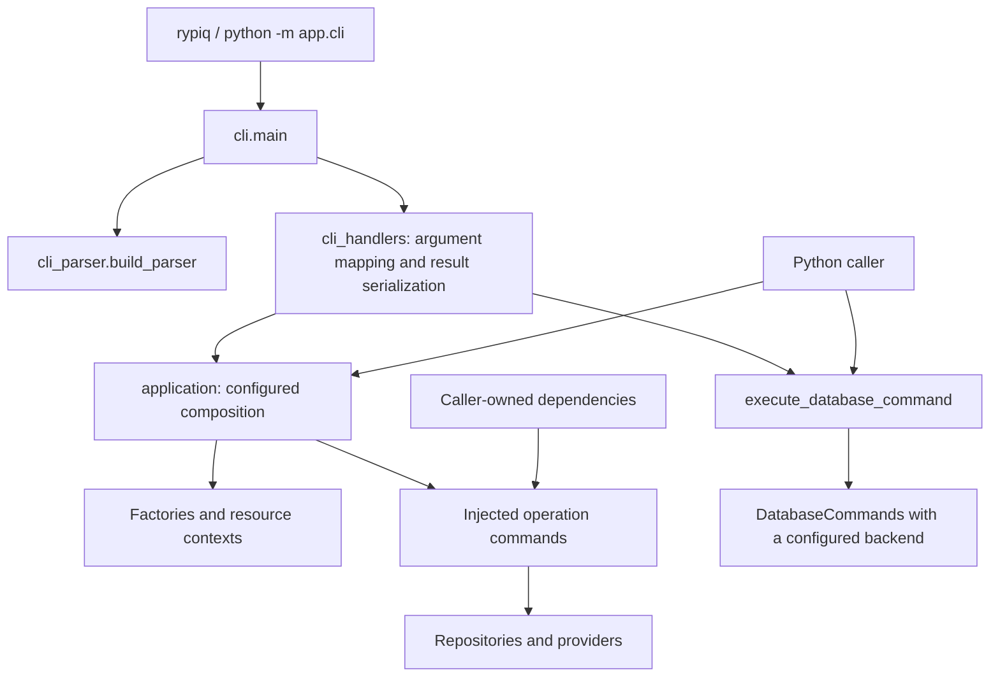

# CLI execution and backend operations

RyPiq exposes the same operations through a CLI and ordinary Python calls. Backend here means a Python library caller, worker, or another application component; no web framework is required.

Database setup, schema, migrations, and CRUD service contracts are documented in [Database](DATABASE.md).

Provider selection, model catalogs, remote endpoints, and chat are described in [Model providers](PROVIDERS.md).

## Execution paths



### CLI path

1. `app.cli.main(argv=None)` accepts either an explicit argument list or process arguments.
2. `app.cli_parser.build_parser()` defines syntax and shared options without constructing resources.
3. `app.cli_handlers` maps parsed values to explicit Python arguments. Its handlers convert domain objects into the existing JSON shapes.
4. `app.application` constructs configured dependencies through factories, invokes shared operations, and releases the resources it owns.
5. `app.cli` writes JSON to stdout (or `embed --output`) and converts failures into sanitized, nonzero exits.

Database handlers use `execute_database_command(command: str)`, which validates the name before creating resources. The injected `DatabaseCommands` facade delegates to the PostgreSQL backend. Supported names remain `db:create`, `db:migrate`, `db:drop`, and `db:reset`.

No core command receives an argparse namespace, prints output, or terminates the process. Namespace-taking database functions remain compatibility adapters only.

### Configured Python path

Use `app.application` when environment configuration and automatic resource ownership are appropriate:

```python
from app.application import create_application, embed_file, ingest_file, search_documents
from app.database.commands import execute_database_command

# Requires an existing configured database; upgrades recognized legacy schemas.
result = execute_database_command('db:migrate')

application = create_application(
    name='Example', embedding_model='models/embeddinggemma-300m-Q4_0.gguf',
    embedding_size=768,
)
vectors = embed_file(
    path='samples/sample.txt', chunk_size=500, stride=400,
    model_path='models/embeddinggemma-300m-Q4_0.gguf',
)
documents = ingest_file(
    application_id=application.id,
    path='samples/sample.txt', chunk_size=500, stride=400,
    model_path='models/embeddinggemma-300m-Q4_0.gguf',
)
matches = search_documents(application_id=application.id, query='What does this document describe?', limit=5)
```

The facade returns Python values: embedding dictionaries, `list[Document]`, or `list[SearchResult]`. It raises exceptions rather than encoding error envelopes. It never prints JSON. Search opens only database and embedding resources; it does not require object-storage configuration. Ingestion opens all three capabilities.

For embedding alone, file/chunk validation occurs before constructing a model. Both configured embedding and the injected command share the same preparation/batching functions. There is one implementation of the embedding algorithm, even though resource construction happens at different boundaries.

For repeated local operations, pass the same optional `model_session` to embedding, ingestion, search, and chat calls inside `with LocalModelSession() as models:`. The session owns cached model providers; the configured calls borrow them while continuing to own their database resources. See [local model sessions](PROVIDERS.md#reusing-local-models) for warmup, lifecycle, and concurrency rules. One-shot calls and CLI commands retain their existing behavior.

### Injected Python path

Use `EmbedTextFile`, `IngestDocument`, or `SearchDocuments` when the caller already owns the dependencies, needs to reuse a loaded model, or wants isolated tests:

```python
from uuid import UUID
from app.application import open_embedding_provider
from app.operations.application import get_application
from app.context import create_context
from app.operations.document import IngestDocument
from app.operations.search import SearchDocuments

with create_context() as context:
    application = get_application(
        application_id=UUID('00000000-0000-0000-0000-000000000001'),
        repository=context.applications,
    )  # Replace the example UUID with an existing application ID.
    with open_embedding_provider(model_path=application.embedding_model) as provider:
        documents = IngestDocument(
            application=application,
            path='samples/sample.txt', chunk_size=500, stride=400,
            embedding_provider=provider,
            repository=context.documents, storage=context.storage,
        ).execute()
        matches = SearchDocuments(
            application=application,
            query='What does this document describe?', limit=5,
            embedding_provider=provider, repository=context.documents,
        ).execute()
```

Constructors only capture inputs. Execution performs validation and effects. Commands borrow their dependencies and never close them. Repeated ingestion creates new stored objects and records; it is not an idempotent retry mechanism.

For database-only library work, prefer `with app.db.open_document_repository() as repository:` or `with get_database() as backend:`. `DatabaseCommands(backend)` can reuse an already-owned backend without loading configuration or closing it. The older `get_document_repository()` factory remains available, but its caller must call `repository.close()`.

## Compatibility and extension points

- `embed_text_file()` retains its signature. `ingest_document()` and `semantic_search()` now require a keyword `application` argument; their result shapes remain unchanged. Configured ingestion/search require `application_id`. Application creation/list/show delegate to reusable operations and repositories; no operation receives CLI namespaces or owns borrowed resources.
- Keep small transformations such as text processing and storage listing as functions. Reuse factories for configured construction instead of placing environment lookups inside a command.
- Add a new CLI command by defining parser syntax, an explicit handler, and an operation or command appropriate to the use case. Keep JSON presentation in handlers and execution/resource ownership in the Python layers.
- Add backend-only behavior directly to the operation layer and test it without importing the CLI. Add a configured facade only when resource construction is genuinely useful to callers.

See [code conventions](CODE_CONVENTIONS.md) for layer responsibilities and [AGENTS.md](../AGENTS.md) for the development workflow.

## Failures and ownership

Ingestion validates embedding results before storing the source file. Repository writes still commit individually; the command does not invent a cross-system transaction. If persistence fails, compensation attempts every record created by that invocation and then its source object. Cleanup failures are added as notes to the original exception instead of replacing it or stopping remaining cleanup.

The configured embedding context closes the provider it constructs. A cleanup failure preserves any active operation error; if the operation finished successfully but cleanup fails, a distinct error reports that partial outcome. Injected providers remain caller-owned.

Local storage stages data in the destination directory and publishes it using an atomic exclusive hard link. This requires filesystem support for same-filesystem hard links. A losing writer cannot replace or delete a winning writer's object. Cleanup only removes owned staging files. A post-publication cleanup error leaves the complete object committed. This is normal-operation publication safety, not a power-loss durability or hostile-directory-mutation guarantee. Staging files may appear in listings while a save is active, and published files inherit the temporary file's restrictive permissions.

## Coverage and regression checks

Install development dependencies into `env` before measuring coverage. Use a disposable PostgreSQL server with pgvector, and set `RYPIQ_TEST_ADMIN_URL` independently of application configuration. Model integration tests use the existing local model or `EMBEDDING_MODEL_PATH`; missing prerequisites are skips, not verified support.

```sh
env/bin/python -m pytest tests --cov=app --cov-branch \
  --cov-config=pyproject.toml --cov-report=term-missing --cov-report=html
```

Coverage includes the entire `app` package and subprocesses used by installed-CLI tests. There are no application-file omissions or added exclusion patterns. The configured gate is **90% combined statement/branch coverage**. Inspect branch gaps and important failure paths as well as the percentage; do not add tests that merely execute abstract stubs to inflate it.

Unit tests cover command contracts, resource ownership, configuration and safe errors. Integration tests exercise actual PostgreSQL/pgvector, the installed CLI, the available local embedding model, and storage publication/compensation. Historical validation reports do not replace a fresh run after a behavioral change.

The recorded refactor run and remaining coverage gaps are in [refactor validation](REFACTOR_VALIDATION.md).
