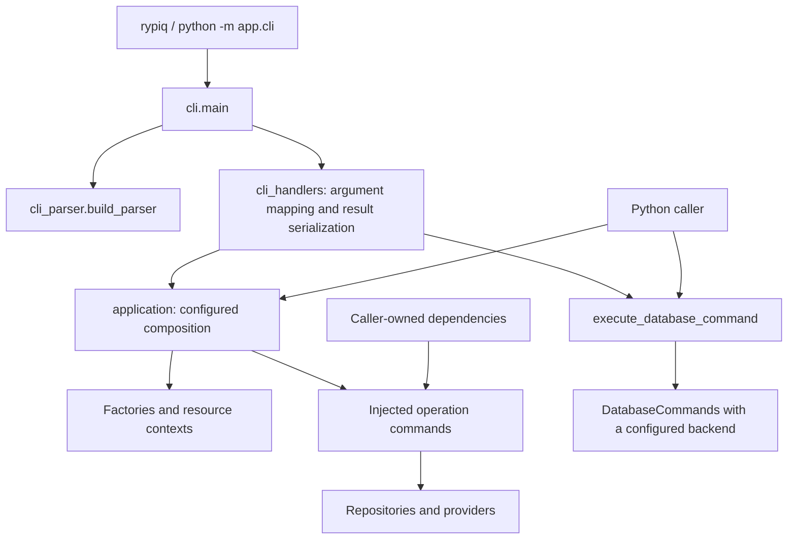

# CLI execution and backend operations

RyPiq exposes the same operations through a CLI and ordinary Python calls. Backend here means a Python library caller, worker, or another application component; no web framework is required.

Database setup, schema, migrations, and CRUD service contracts are documented in [Database](DATABASE.md).

Provider selection, model catalogs, remote endpoints, and chat are described in [Model providers](PROVIDERS.md).

## Execution paths



### CLI path

1. `app.cli.main(argv=None)` accepts either an explicit argument list or process arguments.
2. `app.cli_parser.build_parser()` defines syntax and shared options without constructing resources.
3. `app.cli_handlers` maps parsed values to explicit Python arguments. Its handlers convert domain objects into the existing JSON shapes.
4. `app.application` constructs configured dependencies through factories, invokes shared operations, and releases the resources it owns.
5. `app.cli` formats output: JSON to stdout (with an optional full export for `documents:create`, `documents:show`, and `embeddings:show`), or a text table for `applications:list` and `documents:list` by default. It converts failures into sanitized, nonzero exits.

`applications:list` defaults to a text table and accepts `--output text|json` as a
format selector. Its handler projects only IDs and names from
`application.enumerate_all_applications()`, which owns one database context and
calls `operations.applications.list.list_all_applications()`. The operation reads
100-record pages through the existing repository until exhausted. Presentation
happens only after the complete listing succeeds; failures release the database
without printing partial results. The Python `enumerate_applications()` pagination API remains available.
`applications:delete` delegates through a configured facade and an injected
operation to `ApplicationService.delete()`. The facade owns database cleanup;
the repository enforces deletion restrictions and returns whether a row was deleted.

`documents:create` calls `application.create_document()`, which loads the
application once, resolves its provider and `data.chunking` settings, and delegates
to `IngestDocument`. Missing chunk settings default independently to 500/400.
Document show/delete use the document repository; embedding show/delete use the
embedding repository. Both use database-only facades and globally unique UUIDs.
They neither construct providers nor touch object storage.

`documents:list --application-id UUID` calls `application.enumerate_documents()`.
Its injected `list_documents()` operation verifies the application once, then
fetches 100-row summary pages through `DocumentRepository.list_summaries()`.
Each query joins and counts embeddings without loading their text or vectors.
The facade owns one database context; no providers or storage are constructed.
The handler serializes IDs, names, and current embedding counts. The CLI prints a
text table by default or JSON with `--output json`, only after every page succeeds.

Document ingestion APIs and commands require keyword-only `name`; the CLI requires
`--name`. Names are trimmed and checked for conflicts before embedding or storage.
A database unique constraint remains authoritative if another writer wins the race;
failed ingestion rolls back its rows and compensates its newly stored original.

`app.cli_output` validates export destinations and writes complete JSON through a
temporary file followed by atomic replacement. Export runs only after successful
persistence. Embedding-show console formatting copies the payload and shortens long vectors
unless `--embeddings-full` is set. Document outputs contain chunk summaries without vectors. A failed export reports the persisted IDs and
leaves their records and original files intact; no database rollback is attempted.

Database handlers use `execute_database_command(command: str)`, which validates the name before creating resources. The injected `DatabaseCommands` facade delegates to the PostgreSQL backend. Supported names remain `db:create`, `db:migrate`, `db:drop`, and `db:reset`.

No core command receives an argparse namespace, prints output, or terminates the process. Namespace-taking database functions remain compatibility adapters only.

`rypiq --doctor` is a standalone root option. The entrypoint calls
`app.diagnostics.check_configuration()` and formats its typed report as text.
Diagnostics reuse database validation, storage path loading, and catalog loading.
With valid database configuration, `app.database.diagnostics.check_database()`
opens a dedicated PostgreSQL connection with read-only transactions and connection/query
timeouts, checks pgvector and required table/column names, then releases the pool.
It does not use the migration validator, which creates temporary tables.
Required configuration or database failures exit with status 1; optional catalog
issues remain nonblocking. Invalid
command combinations use the normal argument-error exit status 2.

### Configured Python path

Use `app.application` when environment configuration and automatic resource ownership are appropriate:

```python
from app.application import create_application, create_document, embed_file, search_documents, show_embedding, delete_embedding
from app.database.commands import execute_database_command

# Requires an existing configured database; upgrades recognized legacy schemas.
result = execute_database_command('db:migrate')

application = create_application(
    name='Example', embedding_model='models/embeddinggemma-300m-Q4_0.gguf',
    embedding_size=768,
)
vectors = embed_file(
    path='samples/sample.txt', chunk_size=500, stride=400,
    model_path='models/embeddinggemma-300m-Q4_0.gguf',
)
documents = create_document(application_id=application.id, path='samples/sample.txt', name='Example document')
first = show_embedding(embedding_id=documents.embeddings[0].id)
matches = search_documents(application_id=application.id, query='What does this document describe?', limit=5)
```

The facade returns Python values: embedding dictionaries, `DocumentDetails`, or `list[SearchResult]`. It raises [typed exceptions](EXCEPTIONS.md) rather than encoding error envelopes. It never prints JSON. Search opens only database and embedding resources; it does not require object-storage configuration. Ingestion opens all three capabilities.

File processing dispatches by extension to text extractors for TXT, PDF, DOCX, XLSX, XLS, XLSM, and PPTX before applying shared character chunking. The existing `text-file` names and result contracts remain supported for all formats.

`app.processors.extraction.extract_file()` remains the compatibility entrypoint.
It delegates to `FileTextReader`, which owns file opening/closing and sanitizes parser
errors while preserving filesystem failures. `ExtractorFactory.get(suffix)` selects
an extractor using an explicit, case-insensitive extension mapping. `EXTRACTORS` and
`SUPPORTED_EXTENSIONS` remain available through the compatibility module.

Each processing class has its own defining module:

| Module under `app/processors/` | Class / responsibility |
| --- | --- |
| `file_reader.py` | `FileTextReader`: read using an optionally injected factory |
| `extractors/factory.py` | `ExtractorFactory`: select a format reader |
| `extractors/base.py` | `BaseExtractor`: `extract(stream: BinaryIO) -> str` contract |
| `extractors/text.py`, `pdf.py`, `word.py`, `presentation.py` | TXT, PDF, DOCX, and PPTX readers |
| `extractors/excel.py`, `xls.py` | `ExcelExtractor` for XLSX/XLSM and `XlsExtractor` for XLS |
| `chunkers/base.py` | `BaseChunker`: `chunk(text, *, chunk_size, stride) -> list[dict]` contract |
| `chunkers/character.py` | `CharacterChunker`: overlapping character windows and offsets |
| `text_file.py` | `TextFileProcessor`: coordinate reading, chunking, and result assembly |

`TextFileProcessor(chunk_size, stride, *, reader=None, chunker=None)` accepts injected
components and defaults to `FileTextReader` and `CharacterChunker`. Its existing
constructor validation, result dictionaries, and CLI output are preserved. The
character chunker independently validates options, including for empty input.

Extractors borrow seekable binary streams and release any workbook resources they
create; they never close the input stream. TXT retains UTF-8 decoding and universal
newline handling. Existing format functions and spreadsheet class imports remain
available through compatibility wrappers. Shared worksheet rendering lives in
`extractors/_spreadsheet.py`; text/row normalization stays in `extractors/_text.py`.

To support another format, define a `BaseExtractor` subclass in its own file, register
an instance in the factory's `EXTRACTORS`, and test content, failures, and stream
ownership. Keep constructors free of I/O. New chunking implementations belong in
individual modules under `chunkers/` and implement the shared chunk dictionary contract.

For embedding alone, file/chunk validation occurs before constructing a model. Both configured embedding and the injected command share the same preparation/batching functions. There is one implementation of the embedding algorithm, even though resource construction happens at different boundaries.

For repeated local operations, pass the same optional `model_session` to embedding, ingestion, search, and chat calls inside `with LocalModelSession() as models:`. The session owns cached model providers; the configured calls borrow them while continuing to own their database resources. See [local model sessions](PROVIDERS.md#reusing-local-models) for warmup, lifecycle, and concurrency rules. One-shot calls and CLI commands retain their existing behavior.

### Injected Python path

Use `EmbedTextFile`, `IngestDocument`, or `SearchDocuments` when the caller already owns the dependencies, needs to reuse a loaded model, or wants isolated tests:

```python
from uuid import UUID
from app.application import open_embedding_provider
from app.operations.applications.get import get_application
from app.context import create_context
from app.operations.documents.ingest import IngestDocument
from app.operations.documents.search import SearchDocuments

with create_context() as context:
    application = get_application(
        application_id=UUID('00000000-0000-0000-0000-000000000001'),
        repository=context.applications,
    )  # Replace the example UUID with an existing application ID.
    with open_embedding_provider(model_path=application.embedding_model) as provider:
        documents = IngestDocument(
            application=application,
            path='samples/sample.txt', chunk_size=500, stride=400,
            embedding_provider=provider,
            repository=context.documents, storage=context.storage,
            name='Example document',
        ).execute()
        matches = SearchDocuments(
            application=application,
            query='What does this document describe?', limit=5,
            embedding_provider=provider, repository=context.embeddings,
        ).execute()
```

Constructors only capture inputs. Execution performs validation and effects. Commands borrow their dependencies and never close them. Repeated ingestion requires a distinct name within the application and creates new stored objects and records; it is not an idempotent retry mechanism.

For database-only library work, prefer `with app.db.open_document_repository() as repository:` or `with get_database() as backend:`. `DatabaseCommands(backend)` can reuse an already-owned backend without loading configuration or closing it. The older `get_document_repository()` factory remains available, but its caller must call `repository.close()`.

## Operation namespaces and import migration

Operations now use domain packages and action modules. The former flat import paths
have been removed; Python callers must update their imports. The document/embedding
split also changes ingestion and search result types as described below.

| Former module | New module and exported operations |
| --- | --- |
| `app.operations.application` | `app.operations.applications.create` (`CreateApplication`), `.get` (`get_application`), `.list` (`list_applications`, `list_all_applications`), `.delete` (`delete_application`) |
| `app.operations.document` | `app.operations.documents.ingest` (`IngestDocument`), `.persist` (`persist_document`); `app.application` (`ingest_document`) |
| `app.operations.search` | `app.operations.documents.search` (`SearchDocuments`, `semantic_search`) |
| `app.operations.embedding` | `app.operations.embeddings.embed_file` (`EmbedTextFile`, `prepare_text_file`, `embed_chunks`, `DEFAULT_PREFIX`), `.get` (`get_embedding`), `.delete` (`delete_embedding`); `app.application` (`embed_text_file`) |
| `app.operations.process` | `app.operations.processing.content` (`process_content`, `PROCESSORS`) |
| `app.operations.text_file` | `app.operations.processing.file` (`process_text_file`) |
| `app.operations.storage` | `app.operations.storage.save` (`save_file`), `.list` (`list_files`) |
| `app.operations.chat` | `app.operations.inference.chat` (`Chat`) |

Import from action modules directly; package initializers do not re-export symbols.
For configured calls, use `from app.application import embed_text_file, ingest_document`.
These functions retain local model session borrowing and the local-only restriction
on `ingest_document()`. Ingestion now returns `DocumentDetails`.

New operations belong to their domain package. Document ingestion and search
coordinate document workflows; embeddings contains vector generation and individual
embedding-record access. Processing extracts/chunks content, storage manages files,
and inference contains chat. Keep shared persistence compensation in
`documents.persist`, and dependency construction/cleanup in `app.application`.

## Repository modules and import migration

Each repository interface and PostgreSQL implementation has its own module under
`app.database.repositories`. Interfaces live in `application.py`, `document.py`,
and `embedding.py`; implementations live in the matching modules inside the
`postgresql/` package. Shared UUID, limit, and pagination validation lives in
`app.models.validation`, used directly by operations, services, and repositories.
The former private validation modules retain compatibility imports only.
Import classes directly from their defining modules;
package initializers do not re-export them.

The former imports are removed. Update Python callers using this mapping:

| Class | Former module | New module |
| --- | --- | --- |
| `ApplicationRepository` | `app.database.repositories.base` | `app.database.repositories.application` |
| `DocumentRepository` | `app.database.repositories.base` | `app.database.repositories.document` |
| `EmbeddingRepository` | `app.database.repositories.base` | `app.database.repositories.embedding` |
| `PostgreSQLApplicationRepository` | `app.database.repositories.postgresql` | `app.database.repositories.postgresql.application` |
| `PostgreSQLDocumentRepository` | `app.database.repositories.postgresql` | `app.database.repositories.postgresql.document` |
| `PostgreSQLEmbeddingRepository` | `app.database.repositories.postgresql` | `app.database.repositories.postgresql.embedding` |

Class names, method signatures, persistence behavior, and resource ownership are
unchanged. The backend continues to construct repositories sharing its engine.

## Compatibility and extension points

- `documents:create` replaces `embeddings:create`, `embed`, and `ingest`. Python `create_document()`, `ingest_file()`, `ingest_document()`, and `IngestDocument.execute()` return `DocumentDetails(document, embeddings)`. `show_document()` returns the same type; `show_embedding()` returns `Embedding`. There are no adapters for the former chunk-as-Document contract. Standalone embedding APIs still return their existing dictionaries.
- Search uses the embedding repository and returns `SearchResult(embedding, document, distance)`. Pass optional `metadata_filters` to Python search APIs or `--metadata-filter JSON` to the CLI. The filter is a JSON object matched by JSONB containment before cosine ranking. CLI matches contain both IDs, chunk text/metadata, storage key, and distance.
- Parent `Document` objects carry file information and application ownership. `Embedding` objects carry chunk text, vector, model snapshots, and metadata. `ApplicationContext.embeddings` and `DatabaseBackend.embeddings()` expose the new repository. `DocumentRepository.details()` loads a parent and its ordered children in one statement. Parent and chunk CRUD remain separate from model generation.

- Keep small transformations such as text processing and storage listing as functions. Reuse factories for configured construction instead of placing environment lookups inside a command.
- Add a new CLI command by defining parser syntax, an explicit handler, and an operation or command appropriate to the use case. Keep JSON presentation in handlers and execution/resource ownership in the Python layers.
- Add backend-only behavior directly to the operation layer and test it without importing the CLI. Add a configured facade only when resource construction is genuinely useful to callers.

See [code conventions](CODE_CONVENTIONS.md) for layer responsibilities and [AGENTS.md](../AGENTS.md) for the development workflow.

## Failures and ownership

Injected ingestion rejects a mismatched provider model before reading or embedding the file. Ingestion validates embedding results before storing the source file. The document repository inserts the parent and all embeddings in one transaction. If persistence fails, PostgreSQL rolls back every row and ingestion attempts to delete its newly stored object. Cleanup failures are attached to the original exception as notes. Storage and PostgreSQL still do not share a transaction.

The configured embedding context closes the provider it constructs. A cleanup failure preserves any active operation error; if the operation finished successfully but cleanup fails, a distinct error reports that partial outcome. Injected providers remain caller-owned.

Local storage stages data in the destination directory and publishes it using an atomic exclusive hard link. This requires filesystem support for same-filesystem hard links. A losing writer cannot replace or delete a winning writer's object. Cleanup only removes owned staging files. A post-publication cleanup error leaves the complete object committed. This is normal-operation publication safety, not a power-loss durability or hostile-directory-mutation guarantee. Staging files may appear in listings while a save is active, and published files inherit the temporary file's restrictive permissions.

## Coverage and regression checks

Install development dependencies into `env` before measuring coverage. Use a disposable PostgreSQL server with pgvector, and set `RYPIQ_TEST_ADMIN_URL` independently of application configuration. Model integration tests use the existing local model or `EMBEDDING_MODEL_PATH`; missing prerequisites are skips, not verified support.

```sh
env/bin/python -m pytest tests --cov=app --cov-branch \
  --cov-config=pyproject.toml --cov-report=term-missing --cov-report=html
```

Coverage includes the entire `app` package and subprocesses used by installed-CLI tests. There are no application-file omissions or added exclusion patterns. The configured gate is **90% combined statement/branch coverage**. Inspect branch gaps and important failure paths as well as the percentage; do not add tests that merely execute abstract stubs to inflate it.

Unit tests cover command contracts, resource ownership, configuration and safe errors. Integration tests exercise actual PostgreSQL/pgvector, the installed CLI, the available local embedding model, and storage publication/compensation. Historical validation reports do not replace a fresh run after a behavioral change.

The recorded refactor run and remaining coverage gaps are in [refactor validation](REFACTOR_VALIDATION.md).

## Model-provider construction and discovery

Configured operations resolve application/catalog settings through
`app.providers.resolution`, then borrow a provider from `LocalModelSession` or an
`open_capability_provider()` scope. The latter dispatches to the embedding or
inference factory. CLI and operation result contracts are unchanged.

`app.application.list_models()` loads the catalog, optionally reads the application,
and resolves `DiscoverySettings` for each configured remote capability. It deduplicates
endpoint/credential pairs, opens each through `open_discovery_provider()`, and merges
normalized model lists. No inference model is required for endpoint discovery.

The legacy `create_provider()`/`open_provider()` path still returns combined remote
facades. See [provider namespaces and compatibility](PROVIDERS.md#code-organization-and-imports)
for canonical contract imports and the migration path.
