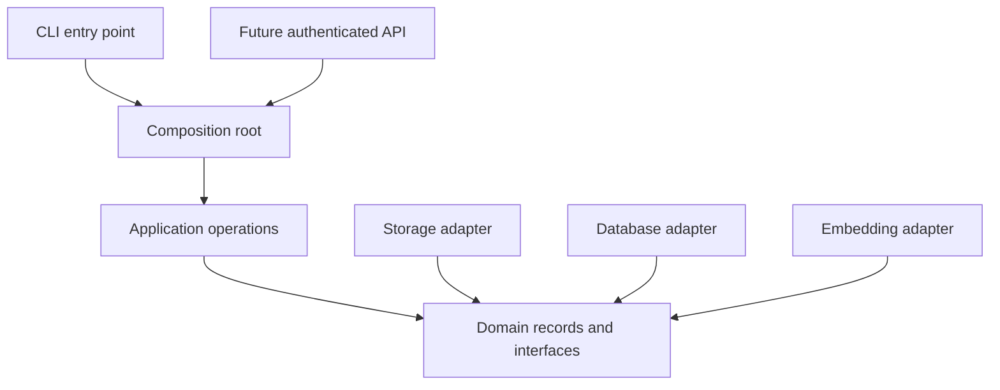

# Module 1: Introduction and project setup

## Learning objectives

- Distinguish ingestion, embedding, indexing, retrieval, and generation.
- Explain SRP, DIP, package discovery, and the composition boundary.
- Install a src-layout package and invoke its installed console script.
- Run a failing test, implement the smallest change, and refactor safely.

## Prerequisites and previous dependencies

Basic Python functions/classes/imports; Linux shell and Python 3.12+ with venv.

## Architecture concepts, patterns, and tradeoffs

RAG means retrieval-augmented generation. Ingestion brings documents into the system; extraction produces text; chunking splits it; embedding maps chunks to numeric vectors; indexing stores those vectors; retrieval compares a query vector to indexed vectors. Generation would supply retrieved text to a language model. **This course builds ingestion and retrieval, not a text-generation model.**

The CLI is an input adapter. Operations coordinate use cases. Domain records and interfaces describe what those operations need. Infrastructure adapters implement those interfaces. Dependencies point inward: a storage adapter may import the storage contract, but a chunker must not import a CLI or database client. Runtime calls can flow outward through an interface without reversing source-code dependencies.

SRP means a chunker changes for chunking reasons, not PDF parser changes. DIP means ingestion receives an embedding interface rather than constructing a particular model. OCP means another loader can be registered without modifying the ingestion algorithm. LSP means replacements preserve ordering, metadata, and failure contracts. ISP means the repository exposes only the operations this application actually needs, rather than a universal persistence framework.

Pattern preview: **Strategy** selects an interchangeable algorithm (format processors and embeddings); **Adapter** translates a library or filesystem API into an application interface; a **simple Factory** selects and constructs an implementation; **Repository** exposes domain persistence instead of Chroma dictionaries. These are ordinary Python objects and functions, not a framework. Dependency injection is passing those objects as arguments. A composition root is the single boundary that assembles them. Their cost is extra names and indirection; introduce them at actual replacement boundaries, not around every function.

A `src` layout keeps the repository root from accidentally making application code importable. Setuptools discovers `ragworkshop` under `src`; editable installation points the interpreter there. `__init__.py` identifies a regular package and should avoid environment reads and expensive initialization. Absolute imports begin with `ragworkshop`, never with the reference application's package. The reference uses a root-level application package; this workshop deliberately teaches installation rather than relying on the current directory.

Unit tests exercise small behavior with fakes; integration tests use a real boundary such as a parser or filesystem; E2E tests compose a complete use case. A subprocess test of `info` is entry-point integration, not a full ingestion E2E test. TDD turns each contract into an executable question before implementation. Red must fail for the intended missing behavior; Green is the smallest working behavior; Refactor changes structure while keeping assertions green.

The future FastAPI entry point would construct the same dependencies. Configuration belongs at entry points, not module import time. Neither a CLI nor an HTTP handler should contain chunking or database logic. YAML contains non-secret adapter/path choices; `.env` is local configuration, not something to commit.



## Architecture diagrams explained

These plain-text diagrams remain readable in a terminal or printed handout. Each diagram states what its arrows mean; a runtime call is different from a source-code dependency. The first two diagrams preview the architecture developed across the course, not additional code to build in this module.

### Follow the data through RAG

Arrows below mean **data produced for the next stage**. Indexing and retrieval happen in separate use cases.

```text
INGESTION
Original file -> Loader -> Extracted text -> Chunker -> Text chunks
                                                        |
                                                        v
                                                Embedding provider
                                                        |
                                                        v
                                            Chunks + numeric vectors
                                                        |
                                                        v
                                                   Vector index

RETRIEVAL
Query -> Same embedding space -> Query vector -> Search vector index
                                                        |
                                                        v
                                            Matching chunks + sources
                                                        |
                                                        v
                                       Generation adapter (future only)
```

**Read the diagram:** a file is not an embedding, and an embedding is not an index. The loader translates file contents into text; the embedding provider turns text into vectors; the repository makes those vectors retrievable. The final generation box is outside the implemented workshop.

**Discuss:** which stage changes when adding PDF support? The loader boundary changes; the query workflow should not need PDF-specific logic.

### Separate construction, use, and implementation

The arrows are labeled because these relationships have different meanings. This is the dependency-inversion design used by the later operations, not a complete Python import graph.

```text
                         CLI / composition root
                         |                   |
                constructs concrete      passes instances
                     adapters                 |
                         |                    v
                         |             Application operation
                         |                    |
                         |                uses contract
                         v                    v
                   Concrete adapter ----> Interface / Protocol
                                     satisfies

Example roles developed later:
  operation : embed_chunks
  contract  : EmbeddingProvider
  adapter   : FakeEmbeddingProvider or LocalEmbeddingProvider
```

**Read the diagram:** the composition root knows which concrete adapter to build. The operation knows the behavior it can request. A fake can satisfy the same contract without pretending to be a GGUF runtime. Composition replaces the supplied object; it does not require an inheritance tree for every component.

**Discuss:** where should a provider-selection environment variable be read? At the construction boundary, before the provider reaches the operation.

### Trace installation and the executable

Arrows mean **build registration or runtime dispatch**, as labeled.

```text
pyproject.toml
  packages.find: where = ["src"] --discovers--> src/ragworkshop/
  scripts: rag-workshop = "ragworkshop.cli:main"
                             |
                       editable install
                             v
                active virtual environment
                  bin/rag-workshop
                             |
                      imports and calls
                             v
                  ragworkshop.cli.main(argv)
                             |
                       parses "info"
                             v
                   stable text on stdout

unit test ---------> main(["info"])
integration test --> installed executable from another working directory
```

**Read the diagram:** the unit test covers function behavior; the integration test additionally covers installation and script registration. Neither requires a model or database. A missing executable belongs to the packaging boundary, not the future RAG pipeline.

## Files and preparation

**Files introduced or replaced in this module:** unchanged files from previous modules remain in place. A test may import a newly introduced TODO module and fail; that is intentional Red, not a dependency on a later module.

```text
rag-workshop/
  pyproject.toml
  .gitignore
  .env.example
  config/database.yml
  config/storage.yml
  README.md
  src/ragworkshop/__init__.py
  src/ragworkshop/processors/__init__.py
  src/ragworkshop/embeddings/__init__.py
  src/ragworkshop/documents/__init__.py
  src/ragworkshop/storage/__init__.py
  src/ragworkshop/database/__init__.py
  src/ragworkshop/operations/__init__.py
  src/ragworkshop/config.py
  src/ragworkshop/context.py
  src/ragworkshop/cli.py
  tests/conftest.py
  tests/unit/test_setup.py
  tests/integration/test_entrypoint.py
  samples/sample.txt
```

**Working directory initially: the repository root containing `workshop/`.** Keep the teaching source and your student project separate; no reference application file needs to change.

```bash
export WORKSHOP_MATERIALS="$PWD/workshop"
mkdir -p "$HOME/rag-workshop"
cd "$HOME/rag-workshop"
python3 --version
# Python 3.12 or newer is required; the delivered examples were tested with 3.14.3.
python3 -m venv .venv
source .venv/bin/activate
mkdir -p config samples tests/{unit,integration,e2e}
mkdir -p src/ragworkshop/{processors,embeddings,documents,storage,database,operations}
cp -R "$WORKSHOP_MATERIALS/starters/module-01/." .
```

The starter creates exact files listed below, including regular-package `__init__.py` files. Inspect and complete the two TODO settings in `pyproject.toml` (script registration and `where = ["src"]`) before installing. Use the provided dependency declarations; installing a native model runtime is not required. On distributions without venv, install the distribution's `python3-venv` package before class.

**Working directory now and for subsequent module commands: `~/rag-workshop/`.**

```bash
python -m pip install -e ".[dev]"
python -m pytest tests/unit/test_setup.py -q
# Red: main still raises NotImplementedError.
```

An installation needs package access or a pre-populated wheel cache; the default test suite itself needs neither network access nor model files. Install dependencies before the class when possible. Reinstall after changing entry points; ordinary editable Python changes are visible immediately.

## Step-by-step walkthrough

1. Create the Linux workspace and virtual environment using the commands below. An editable install belongs to that environment, not the system interpreter.
2. Read the two setup tests before implementing the CLI. One checks the function; the other launches the actual installed script from another directory.
3. Complete setuptools discovery and console-script registration. Install before running the entry-point test; a missing executable is a packaging Red signal.
4. Implement main(argv), return zero on success, and print one stable line. argparse owns usage errors and exit code 2.
5. Add the configuration dataclass and non-secret scaffolding. Keep context.py inert until composition is needed. Re-run tests after extracting or renaming helpers.

## Red — write the tests before implementation

Read the assertions as the behavior contract. Run the relevant test file after each new assertion. A TODO failure is expected; resolve syntax errors, wrong environments, and import mistakes before treating a failure as useful Red. The full test files below are runnable and include their imports.

### `tests/conftest.py`

```python
import pytest


def pytest_addoption(parser):
    parser.addoption("--run-real-model", action="store_true", default=False)


def pytest_collection_modifyitems(config, items):
    if not config.getoption("--run-real-model"):
        for item in items:
            if "real_model" in item.keywords:
                item.add_marker(pytest.mark.skip(reason="requires --run-real-model"))


@pytest.fixture(autouse=True)
def isolated_environment(monkeypatch, tmp_path):
    import os
    for key in list(os.environ):
        if key.startswith("RAG_WORKSHOP_") and not key.startswith("RAG_WORKSHOP_TEST_"):
            monkeypatch.delenv(key)
    monkeypatch.setenv("RAG_WORKSHOP_ENV", "test")
    monkeypatch.setenv("RAG_WORKSHOP_DATABASE_PATH", str(tmp_path / "db"))
    monkeypatch.setenv("RAG_WORKSHOP_STORAGE_ROOT", str(tmp_path / "objects"))
    monkeypatch.setenv("RAG_WORKSHOP_DOTENV", str(tmp_path / "absent.env"))
```

### `tests/unit/test_setup.py`

```python
from ragworkshop.cli import main
from ragworkshop.config import Settings


def test_info(capsys):
    assert main(["info"]) == 0
    assert capsys.readouterr().out == "ragworkshop: modular ingestion and retrieval\n"


def test_default_environment():
    assert Settings().environment == "development"
```

### `tests/integration/test_entrypoint.py`

```python
import subprocess


def test_installed_entrypoint(tmp_path):
    result = subprocess.run(["rag-workshop", "info"], cwd=tmp_path,
                            text=True, capture_output=True, check=False)
    assert result.returncode == 0, result.stderr
    assert result.stdout == "ragworkshop: modular ingestion and retrieval\n"
```

## Green — supplied building blocks and guided implementation

The following supporting code is provided so the core activity fits its time allocation. Study each responsibility after its tests. Complete the activity TODOs using the separate exercise document; compare with the reference solution only during review. These complete files replace their same-named starter files when needed.

Settings is immutable. The resolver selects and validates environment sections, defines relative-path semantics, and reads dotenv only when explicitly called. Tests override paths before constructing adapters.

### `src/ragworkshop/config.py`

```python
from dataclasses import dataclass

@dataclass(frozen=True)
class Settings:
    environment: str = "development"
```

Packaging is also executable configuration. Complete the TODO fields as follows, then reinstall the editable package. The CLI body remains the activity.

### `pyproject.toml`

```toml
[build-system]
requires = ["setuptools>=68"]
build-backend = "setuptools.build_meta"

[project]
name = "ragworkshop"
version = "0.1.0"
description = "Modular ingestion and retrieval workshop"
requires-python = ">=3.12"
dependencies = ["chromadb==1.5.9", "PyYAML==6.0.3", "python-dotenv==1.2.4", "python-docx==1.2.0", "pypdf==6.12.2"]

[project.optional-dependencies]
dev = ["pytest==9.2.0", "reportlab==4.4.10"]
gguf = ["llama-cpp-python==0.3.36"]

[project.scripts]
rag-workshop = "ragworkshop.cli:main"

[tool.setuptools.packages.find]
where = ["src"]

[tool.pytest.ini_options]
testpaths = ["tests"]
addopts = "-ra --import-mode=importlib"
markers = ["real_model: explicitly enabled local GGUF tests"]
```

## Refactor — preserve the contract

argparse keeps runtime dependencies small; Click or Typer could replace only the CLI adapter. A root package layout can work, but src layout makes installation mistakes easier to detect. Protocols versus ABCs will become a concrete choice when a replacement boundary appears.

Ask learners to identify one responsibility that must not move into the CLI. Change one internal helper or simplify one branch, then rerun tests. Do not alter exercise signatures, metadata meaning, or output contracts to make assertions pass.

## Expected tests and CLI behavior

**Working directory: your `rag-workshop/` project root; activate `.venv` first.**

```bash
python -m pytest tests/unit -q
python -m pytest tests/integration -q
python -m pytest -q
rag-workshop info
```

Validated cumulative result: **3 passed**.

Expected: all implemented tests pass; no model tests exist yet.

**Working directory: `rag-workshop/`.** Commands below show observable output fields; JSON whitespace and generated absolute paths/UUIDs are not fixed.

```bash
rag-workshop info
# ragworkshop: modular ingestion and retrieval
rag-workshop --help
# usage includes {info}
python -m ragworkshop.cli info
# ragworkshop: modular ingestion and retrieval
```

## Common errors and troubleshooting

An editable install does not make arbitrary directories part of a package. Missing console scripts usually mean the wrong virtual environment, a missing script table, or failure to reinstall after changing entry points. argparse should exit 2 for invalid commands; package imports should not create data directories.

If tests import the wrong checkpoint, run `python -m pip show ragworkshop` and reinstall from the current project root. Global CLI options go before the subcommand from Module 4 onward. Test commands must run from the project root because the default configuration files are relative to it. Do not run from the parent materials repository.

## Final checkpoint before proceeding

- Distinguish ingestion, embedding, indexing, retrieval, and generation.
- Explain SRP, DIP, package discovery, and the composition boundary.
- Install a src-layout package and invoke its installed console script.
- Run a failing test, implement the smallest change, and refactor safely.
- Run the unit and integration commands above and explain one test that failed before your implementation.
- Have a partner trace a value through the diagram without opening the CLI implementation.
- Compare the activity acceptance criteria to observed behavior; use the matching cumulative reference checkpoint only for recovery.
