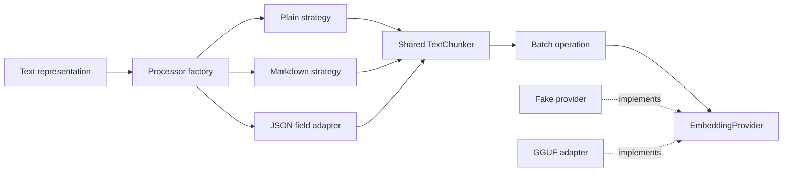

# Module 2: Text handling and embedding abstraction

## Learning objectives

- Calculate chunk boundaries and overlap without confusing stride with size.
- Separate textual representations from chunking and embedding.
- Use a provider interface, factory, batching, and deterministic fakes.
- Validate vectors and distinguish offline adapter tests from opt-in model tests.

## Prerequisites and previous dependencies

Complete Module 1 and keep its source and tests. Start from that checkpoint, never from the final application.

## Architecture concepts, patterns, and tradeoffs

Chunking belongs to `TextChunker`, not format adapters, loaders, or embedding providers. We use characters as Python Unicode code points, not bytes, grapheme clusters, or model tokens. With size 4 and stride 3, `ABCDEFGHIJ` becomes `ABCD`, `DEFG`, `GHIJ`. Overlap is `4 - 3 = 1`. Size 4 and stride 4 do not overlap. A stride larger than size would lose content, so this contract rejects it.

No implicit case-folding, whitespace collapse, or Unicode normalization changes source offsets. An embedding strategy can prepare its own inputs, but chunk text and provenance remain unchanged. Normalization can improve consistency but needs an explicit offset mapping if the UI must highlight original text. Character windows can split words and exceed a model token budget; token-aware or sentence-aware chunking is a stretch exercise. Large chunks retain context but may dilute a match; very small chunks lose context; overlap improves continuity at additional storage and inference cost.

`TextProcessor` is a structural Protocol: an object conforms by providing `process`, without inheritance. Plain, Markdown, and JSON adapters participate as strategies. Each delegates to the same chunker. Markdown remains Markdown source, including headings and punctuation; this is intentionally not a full Markdown-to-plain-text renderer. JSON selects one top-level string field and preserves caller-supplied source metadata. Its offsets refer to the extracted field, not the serialized JSON. Physical DOCX/PDF parsing is a separate concern introduced next module.

`PROCESSORS` is a small registry; `get_processor` is a simple factory, not the GoF subclass-based Factory Method pattern. Adding a registry entry changes construction configuration, while the pipeline and CLI stay closed to new format-specific branches. This is a pragmatic application of OCP, not a promise that no file ever changes.

`EmbeddingProvider.embed(list[str])` returns one finite nonzero vector per input, in input order, with declared dimensionality. Its identity describes an embedding space; equal vector length alone does not mean two models are compatible. `embed_chunks` batches calls and validates each batch. Provider failures propagate rather than silently dropping chunks.

`FakeEmbeddingProvider` counts seven fixed words plus a constant coordinate. It is stable across Python processes, unlike Python's randomized `hash()`. It demonstrates routing and retrieval mechanics, not semantic understanding. `LocalEmbeddingProvider` adapts `llama-cpp-python`, lazily importing it and sorting indexed responses. Its model fingerprint and preprocessing version identify the space. Computing the fingerprint costs a file read but avoids trusting a mutable filename.

The local example uses raw, symmetric input text. Choose an embedding-capable GGUF supporting that usage and configure its actual dimension; arbitrary generation models are unsuitable. Model-specific document/query prefixes and pooling must be implemented as a coherent provider policy and given a different identity. Do not paste one model's prefixes into general operations. Real inference is CPU-only here and loaded once per provider; the optional dependency avoids making a native build a prerequisite for ordinary tests.



## Architecture diagrams explained

The Mermaid overview shows the components. These text diagrams explain their distinct roles, chunk boundaries, and batch contract without requiring a diagram renderer.

### Factory chooses; strategy processes; adapter translates

Arrows mean **selection or method delegation**, as labeled. Only one format strategy and one embedding provider are selected for a given pipeline.

```text
format name
    |
    v
get_processor --looks up--> PROCESSORS registry
    |
    +-- plain -----> PlainTextProcessor ----+
    +-- markdown --> MarkdownTextProcessor -+--> shared TextChunker
    +-- json ------> JsonTextProcessor -----+          |
                        |                             v
                 extracts one field               TextChunk[]
                                                      |
                                                      v
                                                 embed_chunks
                                                      |
                                             calls embed(texts)
                                                      v
                                             EmbeddingProvider
                                                /          \
                                  supplied fake              supplied local
                               fixed lexical vectors       llama_cpp adapter
```

**Read the diagram:** the factory answers “which object?”; the strategy answers “how is this representation processed?”; the local adapter answers “how do we call this external library?” The operation receives the provider instance rather than selecting a model inside each batch. Neither the CLI nor the JSON strategy owns the chunking loop.

**Discuss:** adding another text representation should require a strategy and registration. Which existing operation can remain unchanged? `embed_chunks`, because it receives chunks rather than serialized formats.

### Make stride and overlap visible

Columns below are **character positions**, not time or tokens. Chunk intervals are half-open: the start is included and the end is excluded.

```text
Position:    0 1 2 3 4 5 6 7 8 9
Text:        A B C D E F G H I J
Chunk 0:     A B C D                [0, 4)
Chunk 1:           D E F G          [3, 7)
Chunk 2:                 G H I J    [6, 10)
                   ^     ^
                  reused characters D and G

chunk_size = 4    stride = 3    overlap = 4 - 3 = 1
starts: 0 -> 3 -> 6
stop: chunk 2 already reaches the end; do not emit an extra "J" chunk
```

**Read the diagram:** stride controls the next start; size controls the current window length. Text offsets refer to the representation given to the chunker. JSON-field offsets do not point into JSON punctuation. Unicode code points may occupy several bytes, so byte offsets would be a different contract.

**Discuss:** with size 4 and stride 4, the starts would be 0, 4, and 8. Which characters would be repeated? None.

### Keep batch identity and order stable

Arrows mean **ordered input/output mapping**. Vector names below are symbolic; they do not prescribe numeric values or dimensionality.

```text
chunks:   [c0, c1, c2]      batch_size = 2
                |
                v
call 1:   embed([c0.text, c1.text]) --> [v0, v1]
call 2:   embed([c2.text])          --> [v2]
                |
                v
validate each response:
  count matches batch; numbers finite; vectors nonzero;
  every vector has provider.dimensions coordinates
                |
                v
result:   [v0, v1, v2]
paired:   c0 <-> v0, c1 <-> v1, c2 <-> v2
```

**Read the diagram:** vector length validation alone cannot catch accidental reordering. The local adapter restores the library response's index order before returning it, and the operation preserves batch order. A failed batch raises an error rather than silently producing an incomplete index.

**Discuss:** if the second call returns a different dimension, should the operation return the first batch? No; the complete operation fails, allowing its caller to handle the failure consistently.

## Files and preparation

**Files introduced or replaced in this module:** unchanged files from previous modules remain in place. A test may import a newly introduced TODO module and fail; that is intentional Red, not a dependency on a later module.

```text
rag-workshop/
  src/ragworkshop/cli.py
  src/ragworkshop/processors/chunks.py
  src/ragworkshop/processors/formats.py
  src/ragworkshop/embeddings/base.py
  src/ragworkshop/embeddings/fake.py
  src/ragworkshop/embeddings/local.py
  src/ragworkshop/embeddings/factory.py
  src/ragworkshop/operations/embedding.py
  tests/unit/test_text.py
  tests/unit/test_local.py
  tests/integration/test_real_model.py
  tests/integration/test_text_cli.py
```

**Working directory: `~/rag-workshop/`, with `.venv` active.** `WORKSHOP_MATERIALS` is the absolute materials directory exported in Module 1. This overlay changes only this module's files; it preserves earlier completed exercises. It supplies infrastructure and replaces the exercise bodies with TODOs. Commit or copy your previous checkpoint first if you want to compare it later.

```bash
cp -R "$WORKSHOP_MATERIALS/starters/module-02/." .
python -m pip install -e ".[dev]"
```

Read the supplied scaffolding and write the tests below before filling any TODO. The overlay includes those completed test files as an instructor recovery aid; learners can retype or extend them before implementing behavior. Tests from previous modules remain regression checks.

## Step-by-step walkthrough

1. Begin with the chunk-boundary and invalid-parameter tests. Work the indices out on paper before running them.
2. Implement immutable chunk records and the single chunking loop. Compare code-point offsets to sliced text, including Unicode and repeated content.
3. Read batching, factory, and vector-validation tests. Supply the Protocol and deterministic fake, then implement validation and orchestration.
4. Read the mocked llama_cpp adapter test before studying LocalEmbeddingProvider. Run it with no actual model; distinguish this from the separately marked model integration test.
5. Complete the activity strategies and registry. Use the same chunker instance for all representations and confirm the fake pipeline test.
6. Run process and embed with identical text; discuss why the deterministic lexical demo returns predictable vectors but cannot establish semantic quality.

## Red — write the tests before implementation

Read the assertions as the behavior contract. Run the relevant test file after each new assertion. A TODO failure is expected; resolve syntax errors, wrong environments, and import mistakes before treating a failure as useful Red. The full test files below are runnable and include their imports.

### `tests/unit/test_text.py`

```python
import pytest

from ragworkshop.processors.chunks import TextChunker
from ragworkshop.processors.formats import PROCESSORS, get_processor
from ragworkshop.embeddings.fake import FakeEmbeddingProvider
from ragworkshop.embeddings.factory import get_embedding_provider
from ragworkshop.embeddings.base import validate_vectors
from ragworkshop.operations.embedding import embed_chunks


def test_boundaries():
    chunks = TextChunker(4, 3).chunk("ABCDEFGHIJ", {"source": "memo"})
    assert [(c.start, c.end, c.text) for c in chunks] == [
        (0, 4, "ABCD"), (3, 7, "DEFG"), (6, 10, "GHIJ")]
    assert [c.index for c in chunks] == [0, 1, 2]
    assert all(c.metadata == {"source": "memo"} for c in chunks)


@pytest.mark.parametrize("size,stride", [(0, 1), (4, 0), (4, 5), (-1, 1), (True, 1), (4, 1.5)])
def test_bad_parameters(size, stride):
    with pytest.raises(ValueError):
        TextChunker(size, stride)


@pytest.mark.parametrize("text,expected", [("", []), ("ab", ["ab"]),
    ("aaaaaa", ["aaaa", "aaa"]), ("猫🐍éab", ["猫🐍éa", "ab"])])
def test_edges(text, expected):
    assert [c.text for c in TextChunker(4, 3).chunk(text)] == expected


def test_no_overlap():
    assert [c.text for c in TextChunker(3, 3).chunk("abcdefg")] == ["abc", "def", "g"]


@pytest.mark.parametrize("name,text,field,expected", [
    ("plain", "python", "text", "python"),
    ("markdown", "# python", "text", "# python"),
    ("json", '{"body": "python"}', "body", "python")])
def test_formats_and_pipeline(name, text, field, expected):
    processor = get_processor(name, TextChunker(30, 30), field)
    chunks = processor.process(text, {"source": "memo"})
    assert chunks[0].text == expected
    assert chunks[0].metadata["source"] == "memo"
    vectors = embed_chunks(chunks, FakeEmbeddingProvider())
    assert vectors == [[1.0, 0.0, 0.0, 0.0, 0.0, 0.0, 0.0, 1.0]]


@pytest.mark.parametrize("text", ["{", "[]", "{}", '{"text": 4}'])
def test_bad_json(text):
    with pytest.raises(ValueError):
        get_processor("json", TextChunker()).process(text)


def test_registry_extensible(monkeypatch):
    builder = PROCESSORS["plain"]
    monkeypatch.setitem(PROCESSORS, "custom", builder)
    assert get_processor("custom", TextChunker()).process("hi")[0].text == "hi"
    with pytest.raises(ValueError):
        get_processor("unknown", TextChunker())


def test_factory_and_fake():
    provider = get_embedding_provider()
    assert provider.embed([]) == []
    assert provider.embed(["cat", "python"]) == provider.embed(["cat", "python"])
    assert provider.embed(["cat", "python"])[0] != provider.embed(["cat", "python"])[1]
    with pytest.raises(ValueError):
        get_embedding_provider("unknown")
    with pytest.raises(ValueError):
        get_embedding_provider("local")


def test_batch_order_and_error_propagation():
    class RecordingProvider:
        model_name = "recording"
        dimensions = 1
        def __init__(self):
            self.calls = []
        def embed(self, texts):
            self.calls.append(texts)
            return [[float(ord(text[0]))] for text in texts]
    provider = RecordingProvider()
    chunks = TextChunker(1, 1).chunk("abc")
    assert embed_chunks(chunks, provider, 2) == [[97.0], [98.0], [99.0]]
    assert provider.calls == [["a", "b"], ["c"]]
    def fail(texts):
        raise RuntimeError("provider unavailable")
    provider.embed = fail
    with pytest.raises(RuntimeError, match="unavailable"):
        embed_chunks(chunks, provider)
    with pytest.raises(ValueError):
        embed_chunks(chunks, provider, 0)


@pytest.mark.parametrize("vectors,count,dimensions", [([], 1, 2), ([[1]], 1, 2),
    ([[float("nan")]], 1, 1), ([[True]], 1, 1), ([[0.0]], 1, 1)])
def test_invalid_vectors(vectors, count, dimensions):
    with pytest.raises(ValueError):
        validate_vectors(vectors, count, dimensions)
```

### `tests/unit/test_local.py`

```python
import sys
from types import SimpleNamespace

import pytest

from ragworkshop.embeddings.factory import get_embedding_provider


def test_local_without_model_runtime(monkeypatch, tmp_path):
    path = tmp_path / "placeholder.gguf"
    path.write_bytes(b"test fixture, not a model")
    class Model:
        def __init__(self, **kwargs):
            assert kwargs["embedding"] is True
        def create_embedding(self, texts):
            return {"data": [{"index": i, "embedding": [float(i + 1), 1.0]}
                             for i in reversed(range(len(texts)))]}
        def close(self):
            pass
    monkeypatch.setitem(sys.modules, "llama_cpp", SimpleNamespace(Llama=Model))
    provider = get_embedding_provider("local", str(path), 2)
    assert provider.embed(["a", "b"]) == [[1.0, 1.0], [2.0, 1.0]]
    assert provider.embed([]) == []
    provider.close()
```

### `tests/integration/test_real_model.py`

```python
import os

import pytest

from ragworkshop.embeddings.factory import get_embedding_provider


@pytest.mark.real_model
def test_real_gguf():
    # Dedicated test variables survive the application-settings isolation fixture.
    path = os.getenv("RAG_WORKSHOP_TEST_MODEL")
    if not path:
        pytest.fail("Set RAG_WORKSHOP_TEST_MODEL when opting into real model tests")
    dimensions = int(os.environ["RAG_WORKSHOP_TEST_DIMENSIONS"])
    provider = get_embedding_provider("local", path, dimensions)
    try:
        first = provider.embed(["Python modules", "Vector retrieval"])
        assert len(first) == 2
        assert len(first[0]) == dimensions
        assert provider.embed(["Python modules"])[0] == pytest.approx(first[0], abs=1e-5)
    finally:
        provider.close()
```

### `tests/integration/test_text_cli.py`

```python
import json
import subprocess


def test_process_and_embed_legacy_flags():
    processed = subprocess.run(["rag-workshop", "process", "ABCDEFGHIJ", "--chunk-size", "4", "--stride", "3"],
                               text=True, capture_output=True)
    assert processed.returncode == 0, processed.stderr
    assert [item["text"] for item in json.loads(processed.stdout)["chunks"]] == ["ABCD", "DEFG", "GHIJ"]
    embedded = subprocess.run(["rag-workshop", "embed", "python", "--provider", "fake", "--dimensions", "8"],
                              text=True, capture_output=True)
    assert embedded.returncode == 0, embedded.stderr
    assert json.loads(embedded.stdout)["vectors"] == [[1.0, 0.0, 0.0, 0.0, 0.0, 0.0, 0.0, 1.0]]
```

## Green — supplied building blocks and guided implementation

The following supporting code is provided so the core activity fits its time allocation. Study each responsibility after its tests. Complete the activity TODOs using the separate exercise document; compare with the reference solution only during review. These complete files replace their same-named starter files when needed.

TextChunk stores offsets with content and metadata. TextChunker owns validation and window boundaries, copies metadata per chunk, and avoids a redundant final overlapping tail.

### `src/ragworkshop/processors/chunks.py`

```python
from dataclasses import dataclass, field

Metadata = dict[str, str | int | float | bool]


@dataclass(frozen=True)
class TextChunk:
    index: int
    start: int
    end: int
    text: str
    metadata: Metadata = field(default_factory=dict)


class TextChunker:
    def __init__(self, chunk_size: int = 200, stride: int = 150):
        if (type(chunk_size) is not int or type(stride) is not int
                or not 0 < stride <= chunk_size):
            raise ValueError("Require integer 0 < stride <= chunk_size")
        self.chunk_size = chunk_size
        self.stride = stride

    def chunk(self, text: str, metadata: Metadata | None = None) -> list[TextChunk]:
        chunks = []
        for start in range(0, len(text), self.stride):
            end = min(start + self.chunk_size, len(text))
            chunks.append(TextChunk(len(chunks), start, end, text[start:end],
                                    dict(metadata or {})))
            if end == len(text):
                break
        return chunks
```

The Protocol specifies behavior without requiring inheritance. Implementations and lightweight fakes must preserve this contract. Validation belongs at boundaries so malformed provider output never reaches persistence.

### `src/ragworkshop/embeddings/base.py`

```python
import math
from typing import Protocol


class EmbeddingProvider(Protocol):
    model_name: str
    dimensions: int

    def embed(self, texts: list[str]) -> list[list[float]]: ...


def validate_vectors(vectors: list[list[float]], count: int, dimensions: int) -> None:
    if len(vectors) != count:
        raise ValueError("Embedding count mismatch")
    if type(dimensions) is not int or dimensions < 1:
        raise ValueError("Invalid embedding dimensions")
    for vector in vectors:
        if len(vector) != dimensions:
            raise ValueError("Embedding dimension mismatch")
        if any(type(value) not in (int, float) or not math.isfinite(value)
               for value in vector):
            raise ValueError("Embedding values must be finite numbers")
        if not any(vector):
            raise ValueError("Zero vectors cannot be used for cosine search")
```

This fixed vocabulary produces stable nonzero vectors across processes. It intentionally makes no semantic-quality claim.

### `src/ragworkshop/embeddings/fake.py`

```python
import re


class FakeEmbeddingProvider:
    """Deterministic lexical demo, NOT a semantic embedding model."""
    model_name = "demo-keyword-v1"
    dimensions = 8
    vocabulary = ("python", "cat", "dog", "database", "storage", "text", "vector")

    def embed(self, texts: list[str]) -> list[list[float]]:
        vectors = []
        for text in texts:
            words = re.findall(r"\w+", text.casefold())
            vectors.append([float(words.count(word)) for word in self.vocabulary] + [1.0])
        return vectors
```

The concrete adapter owns external resource handling and validation. Its private helpers centralize invariants so public methods remain small. Inspect the module-specific discussion for the atomic-write or model-response policy.

### `src/ragworkshop/embeddings/local.py`

```python
import hashlib
from pathlib import Path

from ragworkshop.embeddings.base import validate_vectors


class LocalEmbeddingProvider:
    def __init__(self, model_path: str, dimensions: int):
        path = Path(model_path).expanduser().resolve(strict=True)
        if not path.is_file():
            raise ValueError("Model must be a regular file")
        if type(dimensions) is not int or dimensions < 1:
            raise ValueError("Invalid embedding dimensions")
        from llama_cpp import Llama
        with path.open("rb") as stream:
            fingerprint = hashlib.file_digest(stream, "sha256").hexdigest()
        self.model_name = f"gguf:{fingerprint}:raw-v1"
        self.dimensions = dimensions
        self._model = Llama(model_path=str(path), embedding=True, n_gpu_layers=0,
                            n_ctx=2048, verbose=False)

    def embed(self, texts: list[str]) -> list[list[float]]:
        if not texts:
            return []
        response = self._model.create_embedding(texts)
        data = sorted(response["data"], key=lambda item: item["index"])
        if [item["index"] for item in data] != list(range(len(texts))):
            raise ValueError("Missing or duplicate embedding index")
        vectors = [item["embedding"] for item in data]
        validate_vectors(vectors, len(texts), self.dimensions)
        return vectors

    def close(self) -> None:
        self._model.close()
```

A simple factory constructs a supported adapter using explicit arguments and rejects unknown names. It does not reach into global settings.

### `src/ragworkshop/embeddings/factory.py`

```python
from ragworkshop.embeddings.base import EmbeddingProvider
from ragworkshop.embeddings.fake import FakeEmbeddingProvider


def get_embedding_provider(name: str = "fake", model_path: str = "",
                           dimensions: int = 8) -> EmbeddingProvider:
    if name == "fake":
        if dimensions != 8:
            raise ValueError("Fake provider requires 8 dimensions")
        return FakeEmbeddingProvider()
    if name == "local":
        if not model_path:
            raise ValueError("Local provider requires an embedding model path")
        from ragworkshop.embeddings.local import LocalEmbeddingProvider
        return LocalEmbeddingProvider(model_path, dimensions)
    raise ValueError(f"Unsupported embedding provider: {name}")
```

The operation batches chunks and preserves order. It receives a provider rather than constructing one and validates every batch.

### `src/ragworkshop/operations/embedding.py`

```python
from ragworkshop.embeddings.base import EmbeddingProvider, validate_vectors
from ragworkshop.processors.chunks import TextChunk


def embed_chunks(chunks: list[TextChunk], provider: EmbeddingProvider,
                 batch_size: int = 16) -> list[list[float]]:
    if type(batch_size) is not int or batch_size < 1:
        raise ValueError("batch_size must be a positive integer")
    vectors = []
    for start in range(0, len(chunks), batch_size):
        batch = chunks[start:start + batch_size]
        output = provider.embed([chunk.text for chunk in batch])
        validate_vectors(output, len(batch), provider.dimensions)
        vectors.extend(output)
    return vectors
```

## Refactor — preserve the contract

An ABC can enforce abstract-method implementation at instantiation; a Protocol makes tiny fakes easier and avoids forced inheritance. Sentence or token chunkers can replace the character chunker after defining offset semantics. A richer Markdown parser needs declared dependencies and explicit handling of embedded HTML; regular-expression stripping is not a complete parser.

Ask learners to identify one responsibility that must not move into the CLI. Change one internal helper or simplify one branch, then rerun tests. Do not alter exercise signatures, metadata meaning, or output contracts to make assertions pass.

## Expected tests and CLI behavior

**Working directory: your `rag-workshop/` project root; activate `.venv` first.**

```bash
python -m pytest tests/unit -q
python -m pytest tests/integration -q
python -m pytest -q
rag-workshop info
```

Validated cumulative result: **32 passed, 1 skipped**.

Expected: all implemented tests pass; the real-GGUF test is skipped unless explicitly opted in. This skip is expected, not evidence that real inference was tested.

**Working directory: `rag-workshop/`.** Commands below show observable output fields; JSON whitespace and generated absolute paths/UUIDs are not fixed.

```bash
rag-workshop process ABCDEFGHIJ --chunk-size 4 --stride 3
# chunks: ABCD at [0,4), DEFG at [3,7), GHIJ at [6,10)
rag-workshop process '{"body":"python"}' --format json --field body
# one chunk with text "python" and metadata {"field":"body"}
rag-workshop embed python
# model: demo-keyword-v1; vectors: [[1.0,0.0,0.0,0.0,0.0,0.0,0.0,1.0]]
```

### Optional real GGUF integration (outside the core activity)

**Working directory: `rag-workshop/`.** Supply a local embedding-capable GGUF yourself; no download is performed by these commands. Confirm its documented output dimension and raw-text compatibility. Native compilation may need build tools; use a prepared environment for class.

```bash
python -m pip install -e ".[dev,gguf]"
export RAG_WORKSHOP_TEST_MODEL=/absolute/path/to/embedding-model.gguf
export RAG_WORKSHOP_TEST_DIMENSIONS=768
python -m pytest tests/integration/test_real_model.py --run-real-model -q
rag-workshop embed 'python modules' --provider local --model "$RAG_WORKSHOP_TEST_MODEL" --dimensions "$RAG_WORKSHOP_TEST_DIMENSIONS"
```

Expected only with a compatible model: one real-model test passes and CLI JSON contains a model fingerprint and a vector of the configured dimension. Setting a model path alone does not enable real-model tests. From Module 4 onward, global `--embedding-provider`, `--embedding-model`, and `--embedding-dimensions` are also available before `embed`; `.env` can supply them instead. Earlier subcommand options remain supported and take precedence if both CLI forms are supplied.

API reference: [llama-cpp-python embeddings](https://llama-cpp-python.readthedocs.io/en/latest/api-reference/).

## Common errors and troubleshooting

Empty input yields no chunks and no provider calls. Repeated content is not deduplicated. Boolean and fractional sizes are rejected. Missing/duplicate model response indexes, inconsistent dimensions, zero vectors, NaN, and provider exceptions must not produce silently truncated output. Markdown offsets and JSON-field offsets have intentionally different source representations.

If tests import the wrong checkpoint, run `python -m pip show ragworkshop` and reinstall from the current project root. Global CLI options go before the subcommand from Module 4 onward. Test commands must run from the project root because the default configuration files are relative to it. Do not run from the parent materials repository.

## Final checkpoint before proceeding

- Calculate chunk boundaries and overlap without confusing stride with size.
- Separate textual representations from chunking and embedding.
- Use a provider interface, factory, batching, and deterministic fakes.
- Validate vectors and distinguish offline adapter tests from opt-in model tests.
- Run the unit and integration commands above and explain one test that failed before your implementation.
- Have a partner trace a value through the diagram without opening the CLI implementation.
- Compare the activity acceptance criteria to observed behavior; use the matching cumulative reference checkpoint only for recovery.
