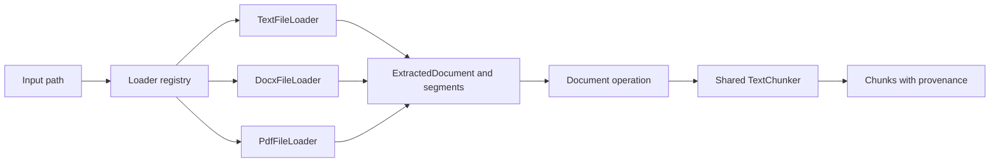

# Module 3: File handling

## Learning objectives

- Separate file I/O and extraction from text processing and embedding.
- Implement TXT, DOCX, and PDF adapters with a common loader interface.
- Preserve paragraph/page provenance and segment-relative offsets.
- Generate small fixtures and test parser errors predictably.

## Prerequisites and previous dependencies

Complete Module 2 and keep its source and tests. Start from that checkpoint, never from the final application.

## Architecture concepts, patterns, and tradeoffs

The filesystem is an input boundary, not a text representation. A `.json` string passed to `process` is already text; a `.docx` path needs a parser. The loader Strategy chooses a file reader by case-insensitive extension. Each concrete loader is also an Adapter: it translates `python-docx` or `pypdf` objects into `ExtractedDocument` and `TextSegment`. The registry owns selection; the operation owns sequencing; the chunker owns window rules.

Extension checking is a routing and error-reporting convenience, not proof of a file's contents. Resolve the supplied path, require a regular file, and let the parser validate the format. Never execute document content. Missing files, permission errors, corrupt formats, and unsupported extensions have distinct causes. Parser exceptions become readable format errors with the original cause retained.

The document is a sequence of text segments. TXT has one segment, DOCX has body paragraphs, PDF has pages. Chunking restarts offsets at each segment; chunk indexes remain unique across the document. Source path, filename, segment index, and paragraph/page number travel with each chunk. Empty segments contribute no chunks, but provenance numbering is not compacted: paragraph 3 remains paragraph 3 even when paragraph 2 was blank.

`python-docx` body paragraphs omit tables, headers, text boxes, and some tracked changes. This is a stated extraction scope, not complete Word document fidelity. PDF page order follows the file, but within-page reading order can be surprising for columns and positioned text. `pypdf` extracts text; it does not OCR scanned images. A scanned-only document yields no usable chunks, and ingestion later rejects it with an OCR hint. Encrypted PDFs are intentionally rejected.

Integration fixtures must contain actual text. A blank `PdfWriter` page cannot prove extraction. ReportLab writes a tiny, deterministic text PDF (`invariant=1`); `python-docx` writes two simple paragraphs. Assertions compare text and provenance rather than DOCX ZIP timestamps or binary equality between separate fixture generations. A permission-denied test injects `PermissionError`; chmod-based tests can behave differently when run as root.



## Files and preparation

**Files introduced or replaced in this module:** unchanged files from previous modules remain in place. A test may import a newly introduced TODO module and fail; that is intentional Red, not a dependency on a later module.

```text
rag-workshop/
  src/ragworkshop/cli.py
  src/ragworkshop/documents/models.py
  src/ragworkshop/documents/loaders.py
  src/ragworkshop/operations/documents.py
  tests/integration/test_documents.py
  tests/unit/test_documents.py
```

**Working directory: `~/rag-workshop/`, with `.venv` active.** `WORKSHOP_MATERIALS` is the absolute materials directory exported in Module 1. This overlay changes only this module's files; it preserves earlier completed exercises. It supplies infrastructure and replaces the exercise bodies with TODOs. Commit or copy your previous checkpoint first if you want to compare it later.

```bash
cp -R "$WORKSHOP_MATERIALS/starters/module-03/." .
python -m pip install -e ".[dev]"
```

Read the supplied scaffolding and write the tests below before filling any TODO. The overlay includes those completed test files as an instructor recovery aid; learners can retype or extend them before implementing behavior. Tests from previous modules remain regression checks.

## Step-by-step walkthrough

1. Read the fake-loader unit test to see how segment offsets differ from document-wide chunk indexes.
2. Walk through the supplied TXT adapter and shared document operation. Neither constructs an embedding provider.
3. Write/run the generated-fixture integration tests before adding DOCX and PDF readers. A parser test must inspect actual text and provenance.
4. Implement the two reader adapters and registry. Preserve blank-paragraph numbering and page numbers; filter unusable chunks in the operation.
5. Use process-file for all three formats, then run corrupt, missing, permission, and unsupported-format tests.
6. Review extraction limitations using a multi-column or scanned PDF only as an optional observation; do not broaden the core exercise into OCR.

## Red — write the tests before implementation

Read the assertions as the behavior contract. Run the relevant test file after each new assertion. A TODO failure is expected; resolve syntax errors, wrong environments, and import mistakes before treating a failure as useful Red. The full test files below are runnable and include their imports.

### `tests/integration/test_documents.py`

```python
from pathlib import Path
import subprocess
import json

import pytest
from docx import Document
from reportlab.pdfgen.canvas import Canvas

from ragworkshop.documents.loaders import get_loader
from ragworkshop.operations.documents import process_document
from ragworkshop.processors.chunks import TextChunker


@pytest.fixture
def documents(tmp_path):
    txt = tmp_path / "lesson.txt"
    txt.write_text("python modules", encoding="utf-8")
    docx = tmp_path / "lesson.docx"
    document = Document()
    document.add_paragraph("python modules")
    document.add_paragraph("database storage")
    document.save(docx)
    pdf = tmp_path / "lesson.pdf"
    canvas = Canvas(str(pdf), invariant=1)
    canvas.drawString(72, 720, "python modules")
    canvas.showPage()
    canvas.drawString(72, 720, "database storage")
    canvas.save()
    return [txt, docx, pdf]


@pytest.mark.parametrize("index", [0, 1, 2])
def test_real_parsers(documents, index):
    path = documents[index]
    chunks = process_document(path, TextChunker(100, 100))
    assert "python modules" in chunks[0].text
    assert chunks[0].metadata["source"] == str(path)
    assert chunks[0].start == 0
    if index == 1:
        assert chunks[1].metadata["paragraph"] == 2
    if index == 2:
        assert chunks[1].metadata["page"] == 2
    result = subprocess.run(["rag-workshop", "process-file", str(path)],
                            text=True, capture_output=True)
    assert result.returncode == 0, result.stderr
    assert "python modules" in json.loads(result.stdout)["chunks"][0]["text"]


def test_missing_unsupported_and_empty(tmp_path):
    with pytest.raises(FileNotFoundError):
        get_loader(tmp_path / "absent.txt").load(tmp_path / "absent.txt")
    with pytest.raises(ValueError, match="Unsupported"):
        get_loader(tmp_path / "file.exe")
    path = tmp_path / "empty.txt"
    path.write_text(" ", encoding="utf-8")
    assert process_document(path, TextChunker()) == []


@pytest.mark.parametrize("suffix", [".pdf", ".docx"])
def test_corrupt_file(tmp_path, suffix):
    path = tmp_path / ("bad" + suffix)
    path.write_bytes(b"invalid")
    with pytest.raises(ValueError, match="Cannot parse"):
        get_loader(path).load(path)


def test_unreadable(monkeypatch, tmp_path):
    path = tmp_path / "locked.txt"
    path.touch()
    def denied(self, **kwargs):
        raise PermissionError("denied")
    monkeypatch.setattr(Path, "read_text", denied)
    with pytest.raises(PermissionError):
        get_loader(path).load(path)
```

### `tests/unit/test_documents.py`

```python
from pathlib import Path
from ragworkshop.documents.models import ExtractedDocument, TextSegment
from ragworkshop.operations import documents
from ragworkshop.processors.chunks import TextChunker


def test_chunking_resets_offsets_but_not_indexes(monkeypatch):
    class Loader:
        def load(self, path):
            return ExtractedDocument(Path("memo.txt"), [
                TextSegment("abcd", {"paragraph": 1}), TextSegment("ef", {"paragraph": 2})])
    monkeypatch.setattr(documents, "get_loader", lambda path: Loader())
    chunks = documents.process_document(Path("memo.txt"), TextChunker(3, 3))
    assert [c.index for c in chunks] == [0, 1, 2]
    assert [c.start for c in chunks] == [0, 3, 0]
    assert chunks[-1].metadata["paragraph"] == 2
```

## Green — supplied building blocks and guided implementation

The following supporting code is provided so the core activity fits its time allocation. Study each responsibility after its tests. Complete the activity TODOs using the separate exercise document; compare with the reference solution only during review. These complete files replace their same-named starter files when needed.

Frozen dataclasses make the boundary records explicit and readable. Metadata is copied when mapping; frozen does not recursively freeze dictionaries.

### `src/ragworkshop/documents/models.py`

```python
from dataclasses import dataclass, field
from pathlib import Path
from ragworkshop.processors.chunks import Metadata


@dataclass(frozen=True)
class TextSegment:
    text: str
    metadata: Metadata = field(default_factory=dict)


@dataclass(frozen=True)
class ExtractedDocument:
    source: Path
    segments: list[TextSegment]
```

The operation combines segments with source metadata, delegates chunking, skips whitespace-only chunks, and assigns document-wide indexes.

### `src/ragworkshop/operations/documents.py`

```python
from dataclasses import replace
from pathlib import Path

from ragworkshop.documents.loaders import get_loader
from ragworkshop.processors.chunks import TextChunk, TextChunker


def process_document(path: Path, chunker: TextChunker) -> list[TextChunk]:
    document = get_loader(path).load(path)
    chunks = []
    for segment_index, segment in enumerate(document.segments):
        metadata = {**segment.metadata, "source": str(document.source),
                    "filename": document.source.name, "segment_index": segment_index}
        for chunk in chunker.chunk(segment.text, metadata):
            if chunk.text.strip():
                chunks.append(replace(chunk, index=len(chunks)))
    return chunks
```

The supplied TXT reader is the example Adapter. This standalone excerpt can be run in a Python file after the loader scaffold exists; keep the actual class in `documents/loaders.py`.

```python
from pathlib import Path
from ragworkshop.documents.models import ExtractedDocument, TextSegment
from ragworkshop.documents.loaders import validate_path

class TextFileLoader:
    def load(self, path: Path) -> ExtractedDocument:
        path = validate_path(path, ".txt")
        return ExtractedDocument(path, [TextSegment(path.read_text(encoding="utf-8"), {"segment": 1})])
```

## Refactor — preserve the contract

A loader registry is easier to extend than an if/elif branch in the CLI. For very few stable formats a factory conditional is acceptable. Whole-document flattening is shorter but loses reliable page/paragraph attribution; segment-based extraction makes that tradeoff explicit.

Ask learners to identify one responsibility that must not move into the CLI. Change one internal helper or simplify one branch, then rerun tests. Do not alter exercise signatures, metadata meaning, or output contracts to make assertions pass.

## Expected tests and CLI behavior

**Working directory: your `rag-workshop/` project root; activate `.venv` first.**

```bash
python -m pytest tests/unit -q
python -m pytest tests/integration -q
python -m pytest -q
rag-workshop info
```

Validated cumulative result: **40 passed, 1 skipped**.

Expected: all implemented tests pass; the real-GGUF test is skipped unless explicitly opted in. This skip is expected, not evidence that real inference was tested.

**Working directory: `rag-workshop/`.** Create the manual demonstration fixtures after installing the dev extra. The same generation approach is tested automatically in temporary directories.

```bash
python - <<'PYFIX'
from pathlib import Path
from docx import Document
from reportlab.pdfgen.canvas import Canvas

Path("samples").mkdir(exist_ok=True)
document = Document()
document.add_paragraph("python modules")
document.add_paragraph("database storage")
document.save("samples/lesson.docx")
canvas = Canvas("samples/lesson.pdf", invariant=1)
canvas.drawString(72, 720, "python modules")
canvas.showPage()
canvas.drawString(72, 720, "database storage")
canvas.save()
PYFIX
```

**Working directory: `rag-workshop/`.** Commands below show observable output fields; JSON whitespace and generated absolute paths/UUIDs are not fixed.

```bash
rag-workshop process-file samples/sample.txt
# one chunk; filename sample.txt; segment_index 0; source is an absolute path
rag-workshop process-file samples/lesson.docx
# two chunks with paragraph values 1 and 2
rag-workshop process-file samples/lesson.pdf
# two chunks with page values 1 and 2
```

## Common errors and troubleshooting

Empty extraction produces no chunks; ingestion later rejects it. Missing files and permission errors are not successful empty documents. A valid suffix with invalid bytes must fail. DOCX tables and PDF OCR remain outside the declared extraction scope; generated fixtures exercise supported content only.

If tests import the wrong checkpoint, run `python -m pip show ragworkshop` and reinstall from the current project root. Global CLI options go before the subcommand from Module 4 onward. Test commands must run from the project root because the default configuration files are relative to it. Do not run from the parent materials repository.

## Final checkpoint before proceeding

- Separate file I/O and extraction from text processing and embedding.
- Implement TXT, DOCX, and PDF adapters with a common loader interface.
- Preserve paragraph/page provenance and segment-relative offsets.
- Generate small fixtures and test parser errors predictably.
- Run the unit and integration commands above and explain one test that failed before your implementation.
- Have a partner trace a value through the diagram without opening the CLI implementation.
- Compare the activity acceptance criteria to observed behavior; use the matching cumulative reference checkpoint only for recovery.
