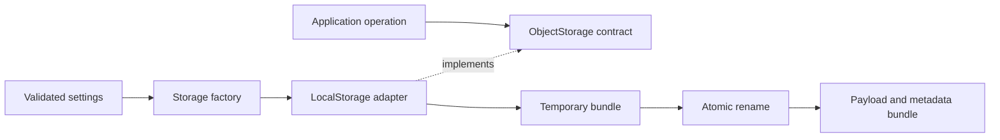

# Module 4: Dealing with storage

## Learning objectives

- Distinguish original-file storage from a vector index.
- Implement an interchangeable object-storage adapter and factory.
- Validate keys, preserve metadata, reject collisions, and publish complete objects.
- Verify filesystem integration using temporary directories and injected failures.

## Prerequisites and previous dependencies

Complete Module 3 and keep its source and tests. Start from that checkpoint, never from the final application.

## Architecture concepts, patterns, and tradeoffs

Object storage preserves original bytes. A vector database indexes chunk vectors and metadata. Embedding computes vectors. These are separate responsibilities even when all three run locally. `StoredObject` contains a logical key, byte size, content type, and SHA-256 checksum; it deliberately exposes no local payload path. A caller retrieves through `get`, which makes a future remote object-store adapter possible.

The ObjectStorage Protocol defines save/get/list/delete/exists. `LocalStorage` adapts files and directories to this contract; `get_storage` is the simple factory. Configuration selects the adapter and root, but business operations receive an already-built object. Replacing local storage must not change an ingestion algorithm that uses only the contract.

Keys are slash-separated logical names. A namespace such as `documents/` groups objects; listing uses literal string-prefix matching, so `doc` also matches `documents/`. Empty keys, absolute paths, traversal components, empty components, backslashes, and NUL are rejected. Prefixes may end in one slash. UUID keys in ingestion avoid accidental filename collisions; direct repeated keys raise `FileExistsError` instead of overwriting data.

Internally the adapter hashes a validated key to a directory name. Each bundle holds `payload` and `metadata.json`. Logical keys remain in metadata. This avoids collisions between a key and another key's metadata filename, and allows `a` and `a/b` to coexist. A temporary sibling bundle is completely populated before an atomic rename publishes it; list ignores staging bundles. Content type and checksum are therefore stable between save and list. Atomic visibility is not a guarantee of durability after power loss; production storage may need fsync and recovery procedures.

The root is trusted and owned by the application. The adapter rejects bundle and payload symlinks, but is not a defense against an attacker concurrently replacing the root directory. It is a single-process teaching adapter, not a multi-writer storage service. `get` uses exclusive destination creation and removes only its own partially written destination on failure. Missing get raises, missing exists is false, and repeated delete returns false. Cleanup must never delete a pre-existing destination.

Settings resolution is supplied scaffolding here and studied fully in Module 5. Read YAML with `safe_load`, validate environment sections, and resolve relative YAML paths relative to the YAML file. CLI/environment path overrides resolve from the working directory. No configuration is loaded during import.



## Architecture diagrams explained

These diagrams distinguish the public object-storage contract from its private local representation. The private layout is an implementation choice, not a promise callers can depend on.

### Inject a storage capability rather than a filesystem path

Arrows mean **construction, injection, or method calls**, as labeled.

```text
settings: adapter="local", root=<configured directory>
                 |
                 v
       get_storage(adapter, root) --constructs--> LocalStorage
                                                       |
                                                  supplied as
                                                       v
caller ----------------------------------------> ObjectStorage
                 save / get / list / exists / delete
                                                       |
                                                  returns data
                                                       v
                        StoredObject(key, size, content_type, checksum)

get(key, destination) returns the caller's chosen destination Path.
StoredObject does not reveal the adapter's internal payload location.
```

**Read the diagram:** the simple factory owns adapter selection; the adapter owns file operations; the caller sees the Protocol's behavior. A later remote provider could download into the same destination contract. Calling `open(stored.key)` would violate this separation because a logical key is not a local path.

**Discuss:** which code changes when adding a remote object store? Add an adapter and factory selection; operations using the existing contract should not need filesystem-specific changes.

### Separate the logical namespace from physical bundles

Arrows mean **validation and internal key mapping**. Angle-bracketed names stand for values computed at runtime.

```text
public key: "documents/lesson.pdf"
                 |
       validate logical key syntax
                 |
         SHA-256 of key string
                 v
trusted root/
  <key digest>/
    payload          <- original file bytes
    metadata.json    <- key, size, content_type, checksum

checksum = SHA-256 of payload bytes
key digest and checksum hash DIFFERENT inputs for DIFFERENT purposes.
```

**Read the diagram:** hashing the key provides an internal address; hashing the payload records content identity. The metadata preserves the original logical key for listing. Source filenames cannot collide with the adapter's metadata filename because each object has its own bundle.

**Discuss:** can `documents/a` and `documents/a/b` coexist? Yes: their distinct key digests produce separate bundles rather than a file/directory conflict.

### Publish complete objects and define failure ownership

Arrows mean **state transitions within save**. The example assumes the trusted, single-writer root described in the contract.

```text
validated source + unused key
            |
            v
create .pending-<unique>/
            |
       write payload
       calculate checksum
       write metadata.json
            |
            +-- failure --> remove staging bundle --> raise original error
            |
       atomic rename
            v
publish <key digest>/
            |
            v
list can now see a complete object with its metadata

Existing key: reject; do not replace its bundle.
get destination exists: reject; do not remove the existing file.
get creates destination then fails: remove only that newly created file.
```

**Read the diagram:** listing ignores staging directories, so a published object contains both bytes and metadata. Atomic visibility does not imply power-loss durability or a transaction with a future vector index. Cleanup ownership is as important as the happy path: the operation may remove artifacts it created, not somebody else's pre-existing data.

**Discuss:** what should the test assert after a simulated rename failure? No published object and no leftover staging directory.

## Files and preparation

**Files introduced or replaced in this module:** unchanged files from previous modules remain in place. A test may import a newly introduced TODO module and fail; that is intentional Red, not a dependency on a later module.

```text
rag-workshop/
  src/ragworkshop/config.py
  src/ragworkshop/cli.py
  src/ragworkshop/storage/base.py
  src/ragworkshop/storage/local.py
  src/ragworkshop/storage/factory.py
  tests/unit/test_config.py
  tests/integration/test_storage.py
```

**Working directory: `~/rag-workshop/`, with `.venv` active.** `WORKSHOP_MATERIALS` is the absolute materials directory exported in Module 1. This overlay changes only this module's files; it preserves earlier completed exercises. It supplies infrastructure and replaces the exercise bodies with TODOs. Commit or copy your previous checkpoint first if you want to compare it later.

```bash
cp -R "$WORKSHOP_MATERIALS/starters/module-04/." .
python -m pip install -e ".[dev]"
```

Read the supplied scaffolding and write the tests below before filling any TODO. The overlay includes those completed test files as an instructor recovery aid; learners can retype or extend them before implementing behavior. Tests from previous modules remain regression checks.

## Step-by-step walkthrough

1. Read the round-trip contract test before touching storage implementation. Trace the same key and metadata through save, list, get, and delete.
2. Study the supplied Protocol, data record, settings resolver, and CLI adapter. Notice that callers never see a payload path.
3. Implement validation and bundle lookup first, then save with staging and publication. Run unsafe-key and collision tests immediately.
4. Implement retrieval, listing, existence, and deletion. Preserve content type and checksum across fresh adapter instances.
5. Inject publication failure and ensure temporary bundles disappear. Demonstrate that a duplicate get leaves the existing destination untouched.
6. Save a Module 3 text file, retrieve it to a new path, and process it with the existing loader pipeline.

## Red — write the tests before implementation

Read the assertions as the behavior contract. Run the relevant test file after each new assertion. A TODO failure is expected; resolve syntax errors, wrong environments, and import mistakes before treating a failure as useful Red. The full test files below are runnable and include their imports.

### `tests/unit/test_config.py`

```python
from pathlib import Path
import pytest
from ragworkshop.config import load_settings
from ragworkshop.storage.factory import get_storage


def test_precedence_and_dotenv(monkeypatch, tmp_path):
    dotenv = tmp_path / "settings.env"
    dotenv.write_text("RAG_WORKSHOP_ENV=production\nRAG_WORKSHOP_STORAGE_ROOT=/unused\n")
    monkeypatch.setenv("RAG_WORKSHOP_DOTENV", str(dotenv))
    selected = tmp_path / "selected"
    settings = load_settings({"storage_root": selected})
    assert settings.environment == "test"
    assert settings.storage_root == selected
    assert settings.database_path == tmp_path / "db"


def test_yaml_relative_paths_and_isolation(monkeypatch, tmp_path):
    monkeypatch.delenv("RAG_WORKSHOP_DATABASE_PATH")
    monkeypatch.delenv("RAG_WORKSHOP_STORAGE_ROOT")
    test = load_settings()
    dev = load_settings({"env": "development"})
    assert test.database_path != dev.database_path
    assert test.storage_root != dev.storage_root
    assert test.storage_root == (Path.cwd() / ".data/test/objects").resolve()
    # Reading settings creates neither environment's persistence directories.


def test_invalid_config(monkeypatch, tmp_path):
    with pytest.raises(ValueError, match="Unknown"):
        load_settings({"env": "typo"})
    bad = tmp_path / "bad.yml"
    bad.write_text("[]")
    with pytest.raises(ValueError, match="section"):
        load_settings({"storage_config": bad})
    with pytest.raises(ValueError, match="Unsupported"):
        get_storage("s3", tmp_path)
```

### `tests/integration/test_storage.py`

```python
import hashlib
import json
import subprocess
from pathlib import Path

import pytest
from ragworkshop.storage.local import LocalStorage


def test_round_trip_metadata_collision_and_delete(tmp_path):
    source = tmp_path / "original.txt"
    source.write_bytes(b"python modules")
    storage = LocalStorage(tmp_path / "objects")
    obj = storage.save(source, "documents/lesson.txt", "text/plain")
    assert obj.checksum == hashlib.sha256(b"python modules").hexdigest()
    assert storage.list("documents/") == [obj]
    assert storage.exists(obj.key)
    destination = storage.get(obj.key, tmp_path / "retrieved.txt")
    assert destination.read_bytes() == source.read_bytes()
    with pytest.raises(FileExistsError):
        storage.save(source, obj.key, "text/plain")
    with pytest.raises(FileExistsError):
        storage.get(obj.key, destination)
    assert destination.read_bytes() == b"python modules"
    assert storage.delete(obj.key) is True
    assert storage.delete(obj.key) is False
    with pytest.raises(FileNotFoundError):
        storage.get(obj.key, tmp_path / "missing.txt")


@pytest.mark.parametrize("key", ["", "../escape", "/absolute", "a/../b", "a//b", "a/./b", "a\\b"])
def test_unsafe_keys(tmp_path, key):
    storage = LocalStorage(tmp_path / "objects")
    with pytest.raises(ValueError):
        storage.exists(key)


def test_symlink_escape(tmp_path):
    storage = LocalStorage(tmp_path / "objects")
    outside = tmp_path / "outside"
    outside.mkdir()
    bundle = storage.root / hashlib.sha256(b"key").hexdigest()
    bundle.symlink_to(outside, target_is_directory=True)
    with pytest.raises(ValueError, match="symlink"):
        storage.exists("key")


def test_save_failure_cleans_staging(monkeypatch, tmp_path):
    import ragworkshop.storage.local as local
    source = tmp_path / "source.txt"
    source.write_text("text")
    storage = LocalStorage(tmp_path / "objects")
    def fail(*args):
        raise OSError("disk failure")
    monkeypatch.setattr(local.os, "rename", fail)
    with pytest.raises(OSError):
        storage.save(source, "key", "text/plain")
    assert list(storage.root.iterdir()) == []
    with pytest.raises(FileNotFoundError):
        storage.save(tmp_path / "missing", "key", "text/plain")


def test_storage_cli_then_document_processing(tmp_path):
    source = tmp_path / "source.txt"
    source.write_text("python modules", encoding="utf-8")
    def run(*args):
        result = subprocess.run(["rag-workshop", *map(str, args)], capture_output=True, text=True)
        assert result.returncode == 0, result.stderr
        return json.loads(result.stdout)
    saved = run("storage:save", source, "documents/source.txt", "--content-type", "text/plain")
    assert run("storage:list")[0] == saved
    destination = tmp_path / "downloaded.txt"
    run("storage:get", saved["key"], destination)
    assert run("process-file", destination)["chunks"][0]["text"] == "python modules"
    assert run("storage:exists", saved["key"]) == {"exists": True}
    assert run("storage:delete", saved["key"]) == {"deleted": True}
```

## Green — supplied building blocks and guided implementation

The following supporting code is provided so the core activity fits its time allocation. Study each responsibility after its tests. Complete the activity TODOs using the separate exercise document; compare with the reference solution only during review. These complete files replace their same-named starter files when needed.

Settings is immutable. The resolver selects and validates environment sections, defines relative-path semantics, and reads dotenv only when explicitly called. Tests override paths before constructing adapters.

### `src/ragworkshop/config.py`

```python
import os
from dataclasses import dataclass
from pathlib import Path
from typing import Any

import yaml
from dotenv import load_dotenv


@dataclass(frozen=True)
class Settings:
    environment: str = "development"
    database_adapter: str = "chroma"
    database_path: Path = Path(".data/development/chroma")
    storage_adapter: str = "local"
    storage_root: Path = Path(".data/development/objects")
    embedding_provider: str = "fake"
    embedding_model: str = ""
    embedding_dimensions: int = 8


def read_section(path: Path, environment: str) -> dict[str, Any]:
    with path.open(encoding="utf-8") as stream:
        try:
            data = yaml.safe_load(stream)
        except yaml.YAMLError as exc:
            raise ValueError("Invalid YAML configuration") from exc
    if not isinstance(data, dict) or not isinstance(data.get(environment), dict):
        raise ValueError("Missing environment configuration section")
    return data[environment]


def load_settings(overrides: dict[str, Any] | None = None) -> Settings:
    """Call at an entry point only; never from business operations."""
    values = overrides or {}
    load_dotenv(os.getenv("RAG_WORKSHOP_DOTENV", ".env"), override=False)
    def choose(key, default):
        if key in values and values[key] is not None:
            return values[key]
        return os.getenv("RAG_WORKSHOP_" + key.upper(), default)
    environment = choose("env", "development")
    if environment not in {"development", "test", "production"}:
        raise ValueError("Unknown application environment")
    database_file = Path(choose("database_config", "config/database.yml")).expanduser().resolve()
    storage_file = Path(choose("storage_config", "config/storage.yml")).expanduser().resolve()
    database = read_section(database_file, environment)
    storage = read_section(storage_file, environment)
    def resolve(key, section, field, config_file, default):
        explicit = key in values or "RAG_WORKSHOP_" + key.upper() in os.environ
        raw = choose(key, section.get(field, default))
        if not isinstance(raw, (str, Path)) or not str(raw).strip():
            raise ValueError(f"Invalid path setting: {key}")
        path = Path(raw).expanduser()
        if not path.is_absolute():
            path = (Path.cwd() if explicit else config_file.parent) / path
        return path.resolve()
    embedding = database.get("embedding", {})
    if not isinstance(embedding, dict):
        raise ValueError("embedding must be a mapping")
    dimensions = int(choose("embedding_dimensions", embedding.get("dimensions", 8)))
    if dimensions < 1:
        raise ValueError("Embedding dimensions must be positive")
    return Settings(
        environment=environment,
        database_adapter=choose("database_adapter", database.get("adapter", "chroma")),
        database_path=resolve("database_path", database, "path", database_file,
                              f"../.data/{environment}/chroma"),
        storage_adapter=choose("storage_adapter", storage.get("adapter", "local")),
        storage_root=resolve("storage_root", storage, "root", storage_file,
                             f"../.data/{environment}/objects"),
        embedding_provider=choose("embedding_provider", embedding.get("provider", "fake")),
        embedding_model=choose("embedding_model", embedding.get("model", "")),
        embedding_dimensions=dimensions,
    )
```

The Protocol specifies behavior without requiring inheritance. Implementations and lightweight fakes must preserve this contract. Validation belongs at boundaries so malformed provider output never reaches persistence.

### `src/ragworkshop/storage/base.py`

```python
from dataclasses import dataclass
from pathlib import Path
from typing import Protocol


@dataclass(frozen=True)
class StoredObject:
    key: str
    size: int
    content_type: str
    checksum: str


class ObjectStorage(Protocol):
    def save(self, source: Path, key: str, content_type: str) -> StoredObject: ...
    def get(self, key: str, destination: Path) -> Path: ...
    def list(self, prefix: str = "") -> list[StoredObject]: ...
    def delete(self, key: str) -> bool: ...
    def exists(self, key: str) -> bool: ...
```

## Refactor — preserve the contract

A file plus sidecar metadata is simpler but needs a publication protocol to avoid mismatched visibility. Bundles solve that here at the cost of hidden internal layout. S3 could implement the same logical interface, but its pagination, conditional writes, and metadata semantics require adapter-specific tests.

Ask learners to identify one responsibility that must not move into the CLI. Change one internal helper or simplify one branch, then rerun tests. Do not alter exercise signatures, metadata meaning, or output contracts to make assertions pass.

## Expected tests and CLI behavior

**Working directory: your `rag-workshop/` project root; activate `.venv` first.**

```bash
python -m pytest tests/unit -q
python -m pytest tests/integration -q
python -m pytest -q
rag-workshop info
```

Validated cumulative result: **54 passed, 1 skipped**.

Expected: all implemented tests pass; the real-GGUF test is skipped unless explicitly opted in. This skip is expected, not evidence that real inference was tested.

**Working directory: `rag-workshop/`.** Commands below show observable output fields; JSON whitespace and generated absolute paths/UUIDs are not fixed.

```bash
rag-workshop --env test storage:save samples/sample.txt documents/sample.txt --content-type text/plain
# JSON: key documents/sample.txt, size 42, content_type text/plain, SHA-256 checksum
rag-workshop --env test storage:list --prefix documents/
# array containing the same StoredObject metadata
rag-workshop --env test storage:exists documents/sample.txt
# {"exists": true}
rag-workshop --env test storage:get documents/sample.txt samples/retrieved.txt
# {"destination": "samples/retrieved.txt"}
rag-workshop process-file samples/retrieved.txt
# original text and source metadata
rag-workshop --env test storage:delete documents/sample.txt
# {"deleted": true}; repeating this command returns {"deleted": false}
```

Run the save/get demonstration once with unused keys/destination paths. A repeat intentionally reports a collision; choose a fresh key and destination for another run.

## Common errors and troubleshooting

Listing a namespace preserves logical keys even though disk directories use hashes. A key and its child prefix can coexist. get must never overwrite an existing path or delete it on failure. Symlink checks assume a trusted root, not hostile concurrent modification. Atomic bundle publication provides visibility, not crash durability or distributed transactions.

If tests import the wrong checkpoint, run `python -m pip show ragworkshop` and reinstall from the current project root. Global CLI options go before the subcommand from Module 4 onward. Test commands must run from the project root because the default configuration files are relative to it. Do not run from the parent materials repository.

## Final checkpoint before proceeding

- Distinguish original-file storage from a vector index.
- Implement an interchangeable object-storage adapter and factory.
- Validate keys, preserve metadata, reject collisions, and publish complete objects.
- Verify filesystem integration using temporary directories and injected failures.
- Run the unit and integration commands above and explain one test that failed before your implementation.
- Have a partner trace a value through the diagram without opening the CLI implementation.
- Compare the activity acceptance criteria to observed behavior; use the matching cumulative reference checkpoint only for recovery.
