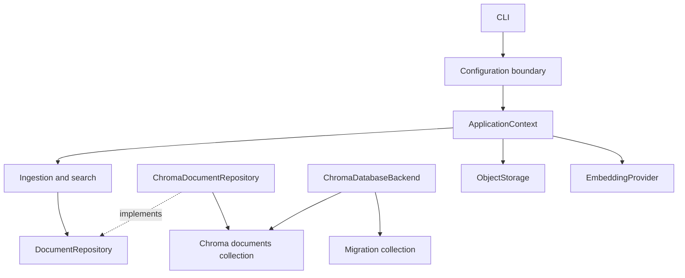
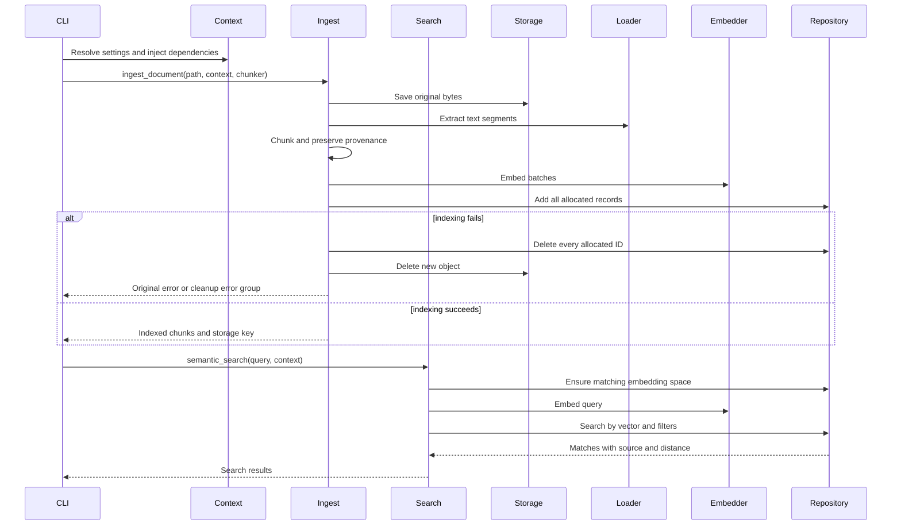

# Module 5: Database, configuration, and end-to-end integration

## Learning objectives

- Separate database lifecycle from document-repository behavior.
- Resolve configuration explicitly and inject application dependencies.
- Ingest, persist, and retrieve chunks in the same embedding space.
- Prove persistence, environment isolation, and compensation using deterministic E2E tests.

## Prerequisites and previous dependencies

Complete Module 4 and keep its source and tests. Start from that checkpoint, never from the final application.

## Architecture concepts, patterns, and tradeoffs

`DatabaseBackend` manages client initialization, collections, and migration bookkeeping. `DocumentRepository` manages application records and vector search. The Repository pattern hides Chroma's nested query dictionaries from operations; the backend Adapter hides connection and collection details. The Factory selects the backend. A dataclass `ApplicationContext` groups injected dependencies without service-location magic or global state.

`Document` maps one chunk to one ID, source ID, content string, embedding, object-storage key, and scalar metadata. `SearchResult` pairs it with a cosine distance: lower is closer, and it is not a calibrated probability. Original bytes remain in object storage. Source ID groups chunks from one ingest; each new ingest intentionally creates a new source ID rather than deduplicating by filename.

Chroma uses `PersistentClient`, explicit vectors, and `embedding_function=None` for both creation and reopening. No default embedding model should be downloaded. Collection-level metadata binds model identity and dimensions. `ensure_space` rejects both dimension mismatch and a different model with the same dimensions. This example supports one embedding space per collection and assumes a single CLI writer. Concurrent initialization, model upgrades, and reindexing require a more deliberate production migration strategy.

Migration `0001` idempotently creates the documents collection, then records completion in a separate collection using an explicit one-dimensional sentinel vector. A failed migration must not be marked complete. This is a minimal schema-lifecycle abstraction, not SQL Alembic or a distributed migration runner. `db:create` initializes persistence; `db:migrate` applies the collection migration; context creation also calls the idempotent migrator for predictable first use.

Configuration precedence is CLI arguments > existing environment > `.env` values loaded without overriding existing environment > selected YAML section > documented defaults. `RAG_WORKSHOP_ENV` selects development/test/production consistently. File-selection variables are `RAG_WORKSHOP_DATABASE_CONFIG` and `RAG_WORKSHOP_STORAGE_CONFIG`; path overrides are `RAG_WORKSHOP_DATABASE_PATH` and `RAG_WORKSHOP_STORAGE_ROOT`. Provider/model/dimensions have matching prefixed variables. YAML can include an `embedding` mapping under the database environment section. Unknown environments fail rather than quietly using development.

Secrets never belong in YAML or examples. Do not print Settings or environment dumps in logs. In this local-only implementation no credentials are required. `python-dotenv` is invoked at the boundary with `override=False`; pytest's `monkeypatch` selects temporary paths and an absent dotenv file. Tests that compare development settings do not initialize those paths. The E2E isolation test initializes a second environment only under its temporary directory.

Ingestion saves the original, extracts/chunks it, embeds in batches, allocates all record IDs, and persists them. Failures after saving compensate by deleting all allocated IDs (including potentially partially written records) and the newly saved object. Both cleanup steps are attempted independently. `ExceptionGroup` preserves the original failure when cleanup also fails. This is compensation, not an atomic transaction across two stores; a process crash may still leave orphans. Search validates the query, embeds it with the same provider, and delegates filtering and ranking to the repository.

The context manager closes only resources it owns; injected providers remain caller-owned. The pinned Chroma client has no public close method, so CLI process exit releases its resources. Do not teach private reset APIs as cleanup. Tests use temporary persistent paths and terminate CLI subprocesses.

A PostgreSQL/pgvector adapter would implement the same repository and backend contracts, translate metadata filters to parameterized queries, and supply its own migrations. A future FastAPI adapter would inject a context, require a secure header checked against an environment-provided secret (constant-time comparison), reject unauthenticated requests before operations, and restrict filesystem access. TLS, upload limits, authorization, and lifecycle management remain deployment requirements. No unauthenticated API is exposed by this course.





## Architecture diagrams explained

The following text diagrams expand the repository and end-to-end overviews. They separate configuration decisions, dependency construction, persistent records, and failure compensation.

### Resolve settings before constructing dependencies

The first arrows mean **fallback precedence for each setting**. The second half shows **construction and injection**; operations receive the resulting objects.

```text
explicit CLI value
       | if absent
       v
existing environment value
       | if absent
       v
.env value (load_dotenv with override=False)
       | if absent
       v
selected YAML environment section
       | if absent
       v
documented default
       |
       v
validated Settings -> create_context(settings, optional supplied provider)
                              |
                              +--> get_database -> backend -> migrate
                              |                       |
                              |                       +--> documents repository
                              |                            + ensure_space
                              |
                              +--> get_storage -> storage adapter
                              |
                              +--> use supplied provider OR construct provider
                              |
                              v
                 ApplicationContext(documents, storage, embeddings)
                              |
                              v
                    ingestion / search operations
```

**Read the diagram:** construction branches show responsibilities, not execution order. The implementation obtains the provider before database setup so its identity and dimension are available for `ensure_space`. The context owns a provider it constructs, but not one supplied by its caller. Environment selection is shared by database and storage; independently chosen environments could accidentally combine test indexes with development originals.

**Discuss:** where should a test replace the embedding provider? Pass the fake to `create_context`; do not patch Chroma to invent query results in the required E2E test.

### Link two stores without confusing their responsibilities

Arrows mean **persistence mapping or references**, not a transaction spanning both stores.

```text
                              source document
                                /         \
                     original bytes     extracted chunks + vectors
                           |                      |
                           v                      v
                     ObjectStorage         DocumentRepository
                           |                      |
                           v                      v
                    local bundle           Chroma records
                    key = K                 id = C0, source_id = S,
                    payload                 storage_key = K, text,
                    checksum                vector, source metadata
                                            id = C1, source_id = S,
                                            storage_key = K, ...

SearchResult.document.storage_key = K --get(K, destination)--> original bytes

Backend: client, collections, migration bookkeeping
Repository: record mapping, space validation, insertion, deletion, search
```

**Read the diagram:** several chunks refer to one original file. The repository translates `Document` records into Chroma inputs and converts query output back to `SearchResult` records. The operation does not unpack Chroma's nested response arrays. A future PostgreSQL adapter would change that translation and the backend lifecycle, while preserving the operation-facing contract.

**Discuss:** why is a returned distance insufficient to identify the original file? Distance is a ranking value; the storage key and source metadata establish the provenance link.

### Trace success and compensation separately

Arrows mean **operation ordering**. This diagram starts after path and embedding-space validation. Record IDs are allocated before any repository write so partial writes can be addressed.

```text
save original -> extract/chunk -> embed -> allocate IDs -> repository.add
      |                                                       |
      | success establishes ownership                         +-- success
      |                                                       |     |
      |                                                       |     v
      |                                                       | return documents
      |                                                       |
      +-- any later failure ----------------------------------+
                         |
                         v
               attempt repository.delete(all allocated IDs)
                         |
               even if that cleanup fails
                         v
               attempt storage.delete(new object's key)
                         |
              +----------+--------------------+
              |                               |
       cleanup succeeds                cleanup also fails
              |                               |
       re-raise original           raise ExceptionGroup containing
              error                 original + cleanup failures

SEARCH
query -> validate -> ensure same embedding space -> embed query
      -> repository.search_by_vector(vector, filters) -> results with source
```

**Read the diagram:** before ID allocation, the cleanup ID list is empty. After a partial database write, deleting every allocated ID covers records whose write succeeded before the adapter raised. Cleanup does not roll back a previous successful ingestion. An abrupt process exit can interrupt compensation, which is why this remains a teaching example rather than a crash-recovery protocol.

**Discuss:** can two models with eight-dimensional outputs share the collection automatically? No; `ensure_space` compares both identity and dimensions. Correct shape alone does not make distances meaningful.

## Files and preparation

**Files introduced or replaced in this module:** unchanged files from previous modules remain in place. A test may import a newly introduced TODO module and fail; that is intentional Red, not a dependency on a later module.

```text
rag-workshop/
  src/ragworkshop/context.py
  src/ragworkshop/cli.py
  src/ragworkshop/database/models.py
  src/ragworkshop/database/base.py
  src/ragworkshop/database/chroma.py
  src/ragworkshop/database/factory.py
  src/ragworkshop/database/migrations.py
  src/ragworkshop/operations/ingestion.py
  src/ragworkshop/operations/search.py
  tests/unit/test_ingestion.py
  tests/integration/test_database.py
  tests/e2e/test_pipeline.py
```

**Working directory: `~/rag-workshop/`, with `.venv` active.** `WORKSHOP_MATERIALS` is the absolute materials directory exported in Module 1. This overlay changes only this module's files; it preserves earlier completed exercises. It supplies infrastructure and replaces the exercise bodies with TODOs. Commit or copy your previous checkpoint first if you want to compare it later.

```bash
cp -R "$WORKSHOP_MATERIALS/starters/module-05/." .
python -m pip install -e ".[dev]"
```

Read the supplied scaffolding and write the tests below before filling any TODO. The overlay includes those completed test files as an instructor recovery aid; learners can retype or extend them before implementing behavior. Tests from previous modules remain regression checks.

## Step-by-step walkthrough

1. Read repository integration tests, then unit failure-compensation tests and deterministic E2E tests before implementing the missing bodies.
2. Walk through explicit settings resolution and monkeypatch isolation. Show which filesystem paths a test will use before constructing dependencies.
3. Use the supplied backend and migration scaffolding. Implement repository space validation, record mapping, filtering, and query result conversion.
4. Implement context composition using already introduced factories. It must accept a caller-supplied fake and must not close a caller-owned provider.
5. Implement ingestion and search. Allocate all IDs before repository writes; attempt both cleanup actions independently.
6. Run the TXT/DOCX/PDF fake-provider E2E tests, reopen the database, and run the installed CLI test across processes.
7. Review remaining production boundaries: process crashes, concurrent writers, model-space migration, authenticated HTTP, and future PostgreSQL.

## Red — write the tests before implementation

Read the assertions as the behavior contract. Run the relevant test file after each new assertion. A TODO failure is expected; resolve syntax errors, wrong environments, and import mistakes before treating a failure as useful Red. The full test files below are runnable and include their imports.

### `tests/unit/test_ingestion.py`

```python
from pathlib import Path
import pytest

from ragworkshop.context import ApplicationContext
from ragworkshop.embeddings.fake import FakeEmbeddingProvider
from ragworkshop.operations import ingestion
from ragworkshop.operations.search import semantic_search
from ragworkshop.processors.chunks import TextChunker
from ragworkshop.storage.base import StoredObject


class MemoryStorage:
    def __init__(self):
        self.keys = set()
    def save(self, source, key, content_type):
        self.keys.add(key)
        return StoredObject(key, 1, content_type, "checksum")
    def delete(self, key):
        self.keys.remove(key)
        return True


class FailingRepository:
    def __init__(self):
        self.records = []
        self.deleted = []
    def ensure_space(self, model_name, dimensions):
        pass
    def add(self, documents):
        self.records = documents[:1]
        raise RuntimeError("partial database write")
    def delete(self, ids):
        self.deleted = ids
        self.records = [doc for doc in self.records if doc.id not in ids]


def test_partial_failure_removes_all_allocated_ids(tmp_path):
    path = tmp_path / "input.txt"
    path.write_text("python cat")
    storage = MemoryStorage()
    repo = FailingRepository()
    context = ApplicationContext(repo, storage, FakeEmbeddingProvider())
    with pytest.raises(RuntimeError, match="partial"):
        ingestion.ingest_document(path, context, TextChunker(5, 5))
    assert len(repo.deleted) == 2
    assert repo.records == []
    assert storage.keys == set()


def test_cleanup_failure_keeps_original_and_attempts_storage(tmp_path):
    path = tmp_path / "input.txt"
    path.write_text("python")
    storage = MemoryStorage()
    repo = FailingRepository()
    def fail(ids):
        raise OSError("cleanup unavailable")
    repo.delete = fail
    with pytest.raises(ExceptionGroup) as error:
        ingestion.ingest_document(path, ApplicationContext(repo, storage, FakeEmbeddingProvider()), TextChunker())
    assert isinstance(error.value.exceptions[0], RuntimeError)
    assert isinstance(error.value.exceptions[1], OSError)
    assert storage.keys == set()


def test_empty_file_compensates(tmp_path):
    path = tmp_path / "empty.txt"
    path.write_text(" ")
    storage = MemoryStorage()
    with pytest.raises(ValueError, match="no extractable"):
        ingestion.ingest_document(path, ApplicationContext(FailingRepository(), storage, FakeEmbeddingProvider()), TextChunker())
    assert storage.keys == set()


@pytest.mark.parametrize("query,limit", [(" ", 1), ("cat", 0), ("cat", True)])
def test_invalid_search(query, limit):
    with pytest.raises(ValueError):
        semantic_search(query, ApplicationContext(FailingRepository(), MemoryStorage(), FakeEmbeddingProvider()), limit)
```

### `tests/integration/test_database.py`

```python
import pytest
from ragworkshop.database.factory import get_database
from ragworkshop.database.models import Document
from ragworkshop.database.migrations import migrate


def test_persistence_filters_and_migrations(tmp_path):
    path = tmp_path / "persistent"
    backend = get_database("chroma", path)
    assert migrate(backend) == ["0001"]
    assert migrate(backend) == []
    repository = backend.documents()
    repository.ensure_space("test-space", 2)
    assert repository.search_by_vector([1.0, 0.0]) == []
    repository.add([Document("id-1", "source-1", "python", [1.0, 0.0], "documents/a.txt", {"page": 1}),
                    Document("id-2", "source-2", "cat", [0.0, 1.0], "documents/b.txt", {"page": 2})])
    fresh = get_database("chroma", path).documents()
    fresh.ensure_space("test-space", 2)
    result = fresh.search_by_vector([1.0, 0.0], filters={"source_id": "source-1", "page": 1})
    assert [match.document.id for match in result] == ["id-1"]
    assert result[0].distance == pytest.approx(0.0)
    assert result[0].document.metadata == {"page": 1}
    with pytest.raises(ValueError, match="space mismatch"):
        fresh.ensure_space("another-model", 2)
    with pytest.raises(ValueError, match="space mismatch"):
        fresh.ensure_space("test-space", 3)
    with pytest.raises(ValueError, match="dimension"):
        fresh.search_by_vector([1.0])
    fresh.delete(["id-1", "id-2"])
    assert fresh.search_by_vector([1.0, 0.0]) == []


def test_backend_factory_rejects_unknown(tmp_path):
    with pytest.raises(ValueError):
        get_database("postgres", tmp_path)
```

### `tests/e2e/test_pipeline.py`

```python
import json
import subprocess
from dataclasses import replace

from docx import Document as DocxDocument
from reportlab.pdfgen.canvas import Canvas
import pytest

from ragworkshop.config import load_settings
from ragworkshop.context import create_context
from ragworkshop.embeddings.fake import FakeEmbeddingProvider
from ragworkshop.operations.ingestion import ingest_document
from ragworkshop.operations.search import semantic_search
from ragworkshop.processors.chunks import TextChunker


@pytest.mark.parametrize("suffix", [".txt", ".docx", ".pdf"])
def test_deterministic_fake_provider_e2e(tmp_path, suffix):
    path = tmp_path / ("lesson" + suffix)
    if suffix == ".txt":
        path.write_text("python python modules", encoding="utf-8")
    elif suffix == ".docx":
        document = DocxDocument()
        document.add_paragraph("python python modules")
        document.save(path)
    else:
        canvas = Canvas(str(path), invariant=1)
        canvas.drawString(72, 720, "python python modules")
        canvas.save()
    settings = load_settings()
    assert settings.environment == "test"
    assert settings.database_path == tmp_path / "db"
    with create_context(settings, FakeEmbeddingProvider()) as context:
        indexed = ingest_document(path, context, TextChunker(100, 100))
        assert context.storage.exists(indexed[0].storage_key)
        destination = context.storage.get(indexed[0].storage_key, tmp_path / ("copy" + suffix))
        assert destination.read_bytes() == path.read_bytes()
    with create_context(settings, FakeEmbeddingProvider()) as fresh:
        results = semantic_search("python python", fresh)
        assert results[0].document.id == indexed[0].id
        assert results[0].document.metadata["filename"] == path.name
    other = replace(settings, environment="development", database_path=tmp_path / "isolated-dev-db",
                    storage_root=tmp_path / "isolated-dev-objects")
    with create_context(other, FakeEmbeddingProvider()) as isolated:
        assert semantic_search("python", isolated) == []
        assert isolated.storage.list() == []


def test_installed_cli_persists_across_processes(tmp_path):
    source = tmp_path / "lesson.txt"
    source.write_text("python modules", encoding="utf-8")
    def run(*args):
        result = subprocess.run(["rag-workshop", *map(str, args)], text=True, capture_output=True)
        assert result.returncode == 0, result.stderr
        return json.loads(result.stdout)
    assert run("db:create") == {"database": "initialized"}
    assert run("db:migrate") == {"applied": ["0001"]}
    assert run("db:migrate") == {"applied": []}
    indexed = run("ingest", source)
    result = run("search", "python", "--source-id", indexed["source_id"])
    assert result[0]["document"]["storage_key"] == indexed["storage_key"]
    assert run("storage:list")[0]["key"] == indexed["storage_key"]
```

## Green — supplied building blocks and guided implementation

The following supporting code is provided so the core activity fits its time allocation. Study each responsibility after its tests. Complete the activity TODOs using the separate exercise document; compare with the reference solution only during review. These complete files replace their same-named starter files when needed.

Frozen dataclasses make the boundary records explicit and readable. Metadata is copied when mapping; frozen does not recursively freeze dictionaries.

### `src/ragworkshop/database/models.py`

```python
from dataclasses import dataclass
from ragworkshop.processors.chunks import Metadata


@dataclass(frozen=True)
class Document:
    id: str
    source_id: str
    content: str
    embedding: list[float]
    storage_key: str
    metadata: Metadata


@dataclass(frozen=True)
class SearchResult:
    document: Document
    distance: float
```

The Protocol specifies behavior without requiring inheritance. Implementations and lightweight fakes must preserve this contract. Validation belongs at boundaries so malformed provider output never reaches persistence.

### `src/ragworkshop/database/base.py`

```python
from typing import Protocol
from ragworkshop.database.models import Document, SearchResult
from ragworkshop.processors.chunks import Metadata


class DocumentRepository(Protocol):
    def ensure_space(self, model_name: str, dimensions: int) -> None: ...
    def add(self, documents: list[Document]) -> None: ...
    def delete(self, ids: list[str]) -> None: ...
    def search_by_vector(self, embedding: list[float], limit: int = 5,
                         filters: Metadata | None = None) -> list[SearchResult]: ...


class DatabaseBackend(Protocol):
    def create_database(self) -> None: ...
    def create_documents_collection(self) -> None: ...
    def applied_migrations(self) -> set[str]: ...
    def record_migration(self, version: str) -> None: ...
    def documents(self) -> DocumentRepository: ...
```

A simple factory constructs a supported adapter using explicit arguments and rejects unknown names. It does not reach into global settings.

### `src/ragworkshop/database/factory.py`

```python
from pathlib import Path
from ragworkshop.database.base import DatabaseBackend


def get_database(adapter: str, path: Path) -> DatabaseBackend:
    if adapter != "chroma":
        raise ValueError(f"Unsupported database adapter: {adapter}")
    from ragworkshop.database.chroma import ChromaDatabaseBackend
    return ChromaDatabaseBackend(path)
```

Migration is a small command record containing a version and callable. Completion is recorded only after apply succeeds; the creation step is idempotent.

### `src/ragworkshop/database/migrations.py`

```python
from collections.abc import Callable
from dataclasses import dataclass
from ragworkshop.database.base import DatabaseBackend


@dataclass(frozen=True)
class Migration:
    version: str
    apply: Callable[[DatabaseBackend], None]


MIGRATIONS = [Migration("0001", lambda backend: backend.create_documents_collection())]


def migrate(backend: DatabaseBackend) -> list[str]:
    backend.create_database()
    applied = backend.applied_migrations()
    completed = []
    for migration in MIGRATIONS:
        if migration.version not in applied:
            migration.apply(backend)
            backend.record_migration(migration.version)
            completed.append(migration.version)
    return completed
```

## Refactor — preserve the contract

A repository with one add(list[Document]) method is sufficient for the use case; do not add unused generic CRUD or an ORM hierarchy. A transaction is preferable within a single relational database, but it does not automatically cover object storage. An outbox or staged-ingestion state machine could improve crash recovery later.

Ask learners to identify one responsibility that must not move into the CLI. Change one internal helper or simplify one branch, then rerun tests. Do not alter exercise signatures, metadata meaning, or output contracts to make assertions pass.

## Expected tests and CLI behavior

**Working directory: your `rag-workshop/` project root; activate `.venv` first.**

```bash
python -m pytest tests/unit -q
python -m pytest tests/integration -q
python -m pytest tests/e2e -q
python -m pytest -q
rag-workshop info
```

Validated cumulative result: **66 passed, 1 skipped, 1 warning**.

Expected: all implemented tests pass; the real-GGUF test is skipped unless explicitly opted in. This skip is expected, not evidence that real inference was tested.

**Working directory: `rag-workshop/`.** Commands below show observable output fields; JSON whitespace and generated absolute paths/UUIDs are not fixed.

```bash
rag-workshop --env test db:create
# {"database": "initialized"}
rag-workshop --env test db:migrate
# {"applied": ["0001"]} on first migration; {"applied": []} thereafter
rag-workshop --env test ingest samples/sample.txt
# JSON contains indexed_chunks: 1, a generated source_id, and documents/<uuid>.txt storage_key
rag-workshop --env test search python --limit 3
# JSON array; each result has document.content, document.storage_key, source metadata, and distance
rag-workshop --env test storage:list
# original document key and checksum remain available
```

### Configuration and manual demo

**Working directory: `rag-workshop/`.** The file is local and ignored by git. Existing exported variables still win over it.

```bash
cp .env.example .env
export RAG_WORKSHOP_ENV=test
rag-workshop db:create
rag-workshop db:migrate
rag-workshop ingest samples/sample.txt
rag-workshop search python
```

Default YAML chooses the lexical fake with dimension 8. A real model requires `RAG_WORKSHOP_EMBEDDING_PROVIDER=local`, `RAG_WORKSHOP_EMBEDDING_MODEL`, and matching `RAG_WORKSHOP_EMBEDDING_DIMENSIONS`; use a new database path to avoid mixing spaces. Do not erase the existing index to bypass a mismatch. A real-model E2E is a stretch exercise, distinct from the required fake-provider E2E.

API reference: [Chroma Python client](https://docs.trychroma.com/reference/python).

## Common errors and troubleshooting

Empty queries, invalid limits, mismatched spaces, and invalid vectors fail before retrieval. Metadata filters use scalar equality and combine multiple entries with AND. Re-ingestion creates a new source, not an upsert. Cleanup failure preserves both errors; process crashes need an operational reconciliation mechanism beyond this workshop. A fresh backend in one process is not enough to prove restart persistence, so the CLI E2E uses separate processes.

If tests import the wrong checkpoint, run `python -m pip show ragworkshop` and reinstall from the current project root. Global CLI options go before the subcommand from Module 4 onward. Test commands must run from the project root because the default configuration files are relative to it. Do not run from the parent materials repository.

## Final checkpoint before proceeding

- Separate database lifecycle from document-repository behavior.
- Resolve configuration explicitly and inject application dependencies.
- Ingest, persist, and retrieve chunks in the same embedding space.
- Prove persistence, environment isolation, and compensation using deterministic E2E tests.
- Run the unit and integration commands above and explain one test that failed before your implementation.
- Have a partner trace a value through the diagram without opening the CLI implementation.
- Compare the activity acceptance criteria to observed behavior; use the matching cumulative reference checkpoint only for recovery.
